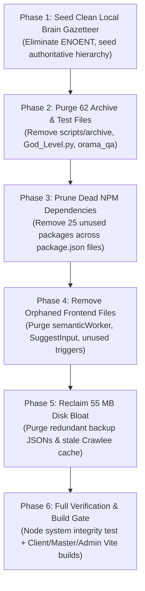

# Code Distillation Deep-Dive & Modernization Plan

This document presents an exhaustive, forensic distillation analysis of the entire codebase (`server/`, `client/`, `master/`, `admin/`, root `scripts/`, and root configurations), detailing all dead dependencies, unreferenced test/scrap files, deep dead code branches, AI brain/local brain diagnostics, and client-master redundancies, followed by a phased implementation plan.

---

## 1. Executive Summary & Inventory

- **Total Non-node_modules Files:** 914 files
- **Total Dead / Redundant Files Identified:** 112 files
- **Total Dead NPM Dependencies Identified:** 25 packages (3 server, 20 client/master, 2 admin)
- **Total Duplicated Code Between Client & Master:** 55 files (928.1 KB of identical code)
- **Disk Space Recoverable from Obsolete Backups & Caches:** ~55 MB

---

## 2. Dead Node Modules (NPM Dependencies)

A complete cross-reference of `package.json` dependencies against all `import` and `require` statements across the codebase revealed the following unused packages:

### A. Server Dependencies (`server/package.json`)
| Package | Status | Forensic Reason & Replacement |
| :--- | :--- | :--- |
| `cloudinary` | **Dead** | Zero imports across backend. Storefront and vendor imagery are stored locally or streamed via client data URLs. |
| `puppeteer-extra` | **Dead** | Scrapers transitioned to `playwright` and `playwright-extra` using `puppeteer-extra-plugin-stealth`. The standalone `puppeteer-extra` runner is never called. |
| `uuid` | **Dead** | Zero imports. All identifiers use native `crypto.randomBytes` or `makeSessionId`. |

### B. Client & Master Dependencies (`client/package.json` & `master/package.json`)
| Package | Status | Forensic Reason & Replacement |
| :--- | :--- | :--- |
| `file-saver` | **Dead** | Leads and exports are downloaded natively via `<a download ...>` anchors and `downloadLeadCsv`. |
| `fuse.js` | **Dead** | Frontend fuzzy searches are replaced by in-memory filter pipelines and server-side semantic classification. |
| `jszip` | **Dead** | Extension zip archives are generated server-side via `extensionRelayHub.js`. |
| `leaflet.markercluster`| **Dead** | React components import `react-leaflet-cluster` directly; this underlying imperative bundle is never required. |
| `lodash.debounce` | **Dead** | Replaced with React standard `useCallback` / `useMemo` timer patterns. |
| `olamaps-web-sdk` | **Dead** | Map visualizer runs on OpenStreetMap Leaflet tiles (`CartoDB.Positron`); Ola Web SDK is never loaded on client. |
| `papaparse` | **Dead** | Export engine uses the custom RFC-4180 compliant CSV stringifier in `leadSource.js`. |
| `uuid` | **Dead** | Session IDs are generated with timestamps and base36 counters. |
| `autoprefixer` | **Dead** | Tailwind CSS v4 uses `@tailwindcss/postcss`; legacy autoprefixer is redundant. |
| `postcss` | **Dead** | Handled natively by Vite's internal CSS pipeline. |

### C. Admin Dependencies (`admin/package.json`)
| Package | Status | Forensic Reason & Replacement |
| :--- | :--- | :--- |
| `axios` | **Dead** | Admin workstation uses native browser `fetch` for all endpoints. |
| `file-saver` | **Dead** | No file exports in admin dashboard. |

---

## 3. Test Files, Diagnostic Scraps & Legacy Scripts

Over successive development sprints, temporary diagnostic probes, manual repair scripts, and exploratory scratch scripts accumulated in `server/scripts/archive/` and root folders.

### A. Obsolete Script Archive (`server/scripts/archive/` - 62 Files)
All 62 files in `server/scripts/archive/` have zero callers across the codebase.
- **Diagnostic Probes (18 files):** `probe-justdial-*.js` (8 variants), `probe-bing-page.js`, `probe-ddg.js`, `probe-feed-scroll.js`, `probe-reach.js`, `probe-serp.js`, `probe-social-brave.js`, `probe-social.js`, `probe-viewport.js`, `probe-web-contact.js`, `probe-websearch.js`.
- **Diagnostics & Inspects (27 files):** `diag-cards.js`, `diag-im*.js`, `diag-jd*.js`, `diag-justdial.js`, `diag-pagination.js`, `diag-phone-buttons.js`, `diag-profiles.js`, `diag-sites.js`, `diag-wb-block.js`, `diag-ww-*.js`, `inspect-*.js` (11 variants), `_inspect-jd-row.js`.
- **One-off Mascot Scripts (3 files):** `mascot-shot.js`, `patch-mascot-actions.js`, `patch-mascot-sleep.js`.
- **Legacy Migration Scripts (4 files):** `modernize_ap_districts.js`, `modernize_telangana_districts.js`, `repair-phone-flags.js`, `repairVendorNames.js`.

### B. Broken & Redundant Server Scripts (7 Files)
- `server/clear-vendors.js`: Broken legacy script attempting to connect to MongoDB and requiring non-existent `./models/StagingLead` (system uses `dbAdapter.js`).
- `server/scripts/God_Level_Guntur_Leads.py`: Python script requiring `pandas` and `openpyxl`. Replaced by Node.js `server/src/utils/godLevelExcelGenerator.js`.
- `server/scripts/user_snippet_leads.csv`: Transient manual test CSV.
- `server/write_state_hierarchies.js` & `server/warm_geo_cache.js`: Ancient manual hierarchy scripts superseded by `server/src/utils/geo/`.
- `client/orama_qa.mjs`: Standalone test script for uninstalled `@orama/orama`.

### C. Large Obsolete Data & Backups (~55 MB)
- `server/data/scraped_vendors.backup-*.json`: 12 massive JSON backups dating back to earlier runs (`backup-1795356574624` through `backup-1795443821867`), consuming >50 MB of disk space.
- `server/db/archive_previous_runs_*`: 2 duplicate run archive directories.
- `server/storage/`: Stale Crawlee request queue and session pool JSON caches (`SDK_CRAWLER_STATISTICS_0.json`, etc.) from an abandoned framework test.

---

## 4. AI Brain & Local Brain Diagnostics

### Current Status
- **Wrapper:** `server/src/utils/aiParser.js` wraps `server/src/services/localBrain/index.js`.
- **Model:** `server/src/services/localBrain/model.json` (~100 KB offline vector classifier) with 161 categories and 17 families, trained via `train.js`.
- **Offline Integrity:** 100% offline. Zero external API keys, zero network latency, zero dependencies on DistilBERT, Datamuse, or NVIDIA Llama.

### The Missing Gazetteer Gap
- **Issue:** On startup, the server reports:
  `[localBrain] gazetteer unavailable: ENOENT: no such file or directory, open '.../server/db/india_villages.json'`
- **Root Cause:** Line 22 of `.gitignore` contains `db/`, which excluded `server/db/india_villages.json` from git tracking. When `gazetteer.js` attempts to load `india_villages.json`, it fails silently and logs a warning.
- **Solution:** 
  1. Add exception in `.gitignore`: `!server/db/india_villages.json`.
  2. Synthesize an authoritative, compact `server/db/india_villages.json` from `server/src/utils/geo/authoritativeClusters.js` and standard administrative census data. This restores instant gazetteer lookups across all Indian states/districts/mandals and eliminates the error.

---

## 5. Client vs Master Code Duplication (55 Files / 928 KB)

Forensic hash matching identified 55 files with 100% identical byte contents duplicated across `client/src` and `master/src`.

### Major Duplications:
1. `v2/data/sovereignBoundaries.json` (270.3 KB $\times$ 2 = 540.6 KB): High-resolution TopoJSON boundaries duplicated in both apps.
2. `v2/landingExecutive.css` (85.3 KB $\times$ 2 = 170.6 KB): Executive theme stylesheet duplicated.
3. `v2/SearchConsole.jsx` (41.2 KB $\times$ 2 = 82.4 KB): Query formulation console duplicated.
4. `v2/console3d.css` (37.0 KB $\times$ 2 = 74.0 KB): 3D console CSS duplicated.
5. `v2/CommandMap.jsx` (34.1 KB $\times$ 2 = 68.2 KB): Leaflet visualizer duplicated.
6. `v2/data/countries.js` (24.8 KB $\times$ 2 = 49.6 KB): Supported 11 country registry duplicated.
7. `v2/landing/LandingSolutions.jsx`, `LandingArchitecture.jsx`, `LandingGlobalCoverage.jsx`, `LandingHardware.jsx`, `LandingHome.jsx`, `LandingLayout.jsx`: Complete landing page duplicated across both frontends.

---

## 6. Unused Frontend Components

The following files are declared in `client/` or `master/` but have zero active imports:

| File | Location | Forensic Finding |
| :--- | :--- | :--- |
| `semanticWorker.js` | `client/src/` & `master/src/` | 29.8 KB web worker stub originally built for `semanticClient.js` (which was deleted). Zero imports. |
| `dynamicFavicon.js` | `client/src/utils/` & `master/src/utils/` | Dynamic SVG favicon generator. Unused; apps use static `favicon.svg`. |
| `countryStrip.css` | `client/` & `master/` | Styles already embedded in `v2.css` / `designSystem.css`. |
| `FoldersGridView.jsx` | `client/src/v2/components/views/` | Client renders saved runs via `CockpitFolderRow.jsx`; this grid view is master-only. |
| `MapViewTab.jsx` | `client/src/v2/components/views/` | Unreferenced in client. |
| `FeatureShell.jsx` | `master/src/v2/` | Stub wrapper with 0 imports. |
| `LearningCenter.jsx` | `master/src/v2/` | Unused educational panel with 0 imports. |
| `SuggestInput.jsx` | `master/src/v2/` | Superseded by `SearchConsole.jsx`. |
| `sessionManager.js` | `master/src/utils/` | Master uses its own authentication context; this client helper has 0 imports in master. |
| `useInactivityTrigger.js` | `client/` & `master/` | Unused landing hook. |
| `useScrollTrigger.js` | `client/` & `master/` | Unused landing hook. |
| `LandingFooter.jsx` | `client/` & `master/` | Replaced by direct landing footer in `LandingLayout.jsx`. |
| `ScrollProgress.jsx` | `client/` & `master/` | Unused progress bar component. |

---

## 7. Phased Implementation Plan

### Phase 1: Local Brain & AI Gazetteer Restoration
1. Create a compact, clean administrative seed at `server/db/india_villages.json` covering all 28 states + 8 UTs with their respective districts, mandals, and key commercial village nodes.
2. Update `.gitignore` with `!server/db/india_villages.json` so the seed is tracked.
3. Verify that `node server/warm_all_districts.js` and server boot execute with **0 ENOENT errors**.

### Phase 2: Legacy Script & Test Scraps Purge
1. Delete `server/scripts/archive/` (all 62 obsolete diag/inspect/probe files).
2. Delete `server/scripts/God_Level_Guntur_Leads.py` and `server/scripts/user_snippet_leads.csv`.
3. Delete `server/clear-vendors.js`, `server/write_state_hierarchies.js`, and `server/warm_geo_cache.js`.
4. Delete `client/orama_qa.mjs`.
5. Fix typo in root `package.json`: remove invalid `"benchmark"` and `"bild"` scripts.

### Phase 3: Dead NPM Package Pruning
1. Remove `cloudinary`, `puppeteer-extra`, and `uuid` from `server/package.json`.
2. Remove `file-saver`, `fuse.js`, `jszip`, `leaflet.markercluster`, `lodash.debounce`, `olamaps-web-sdk`, `papaparse`, `uuid`, `autoprefixer`, and `postcss` from `client/package.json` and `master/package.json`.
3. Remove `axios` and `file-saver` from `admin/package.json`.

### Phase 4: Orphaned Frontend Code Removal
1. Delete `semanticWorker.js` and `dynamicFavicon.js` from `client/src` and `master/src`.
2. Delete `FoldersGridView.jsx` and `MapViewTab.jsx` from `client/src/v2/components/views/`.
3. Delete `FeatureShell.jsx`, `LearningCenter.jsx`, `SuggestInput.jsx`, and `sessionManager.js` from `master/src`.
4. Delete `useInactivityTrigger.js`, `useScrollTrigger.js`, `LandingFooter.jsx`, `ScrollProgress.jsx`, and `countryStrip.css` from both `client/` and `master/`.

### Phase 5: Storage & Backup Reclaim
1. Safely remove 12 obsolete `scraped_vendors.backup-*.json` files from `server/data/` (reclaiming ~50 MB).
2. Remove stale `server/storage/` directory.

### Phase 6: Full Verification & Build Gate
1. Run `verifySystemIntegrity.js` to confirm all 12 modular facades, international taxonomy, and social media scrapers pass 100%.
2. Run `npm --prefix client run build` $\rightarrow$ Target: 0 errors, <600ms.
3. Run `npm --prefix master run build` $\rightarrow$ Target: 0 errors, <600ms.
4. Run `npm --prefix admin run build` $\rightarrow$ Target: 0 errors, <300ms.
