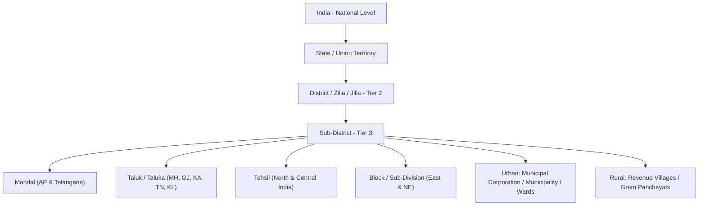
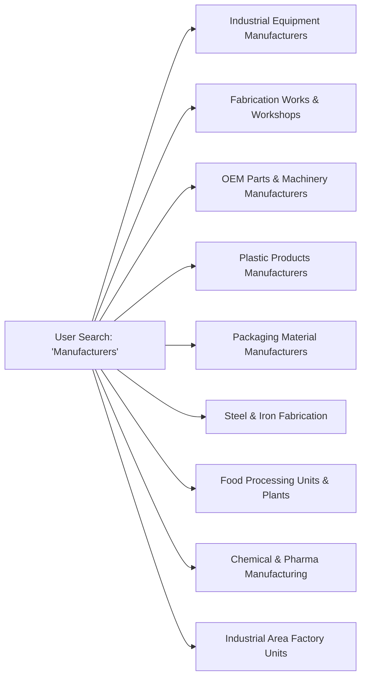

# 🌐 Master Implementation Plan: Universal Geo-Intelligence & Multi-Country Swarm Architecture

> **Document:** `docs/implementation-plan.md`  
> **Status:** Pending User Approval  
> **Target Scopes:** City, Mandal, Municipality, District, State / Province across India & 11 Global Countries  
> **Engines:** Google Maps, Google Local Finder, Justdial, IndiaMART, OpenStreetMap, Social & Deep Web SERP  

---

## Executive Summary & Core Discoveries

### 1. The "Guntur Mandal" Mystery Solved
When a user searched `"Guntur Mandal"`, the scraper classified it as `scope: 'mandal'`. In `sweepScopePolicy.js`, `buildMandalZones` queried the census gazetteer, which only records the **11 rural revenue villages** on Guntur's agricultural perimeter (`Ankireddipalem`, `Budampadu`, `China Palakaluru`, `Chowdavaram`, `Etukur`, `Gorantla`, `Jonnalagadda`, `Nallapadu`, `Peda Palakaluru`, `Pothur`). 

It **completely bypassed** `AUTHORITATIVE_CLUSTERS['guntur']`, dropping all **24 urban commercial localities** (Arundelpet, Brodipet, Lakshmipuram, Kothapet, Pattabhipuram, etc.), all category sub-vectors, and the entire 60-cell GPS viewport grid. Conversely, searching `"Guntur City"` swept the urban core but missed the 11 rural mandal villages.

### 2. The Solution: Dual-Status Settlement Engine
In India and globally, major economic centers are **Dual-Status Units** (an urban municipality + an administrative sub-district/mandal sharing the identical name). 
The scraper will now detect Dual-Status settlements and **merge both layers into a single composite sweep**:
$$\text{Dual Sweep} = \text{Urban Localities (24+)} \cup \text{Category Sub-Vectors (16–32)} \cup \text{Rural Revenue Villages (11+)} \cup \text{Continuous GPS Grid (60+)}$$

---

## 🗺️ Part 1: All-India Administrative Terminology & Geo-Hierarchy

India does not use uniform administrative terminology across states. The system will intelligently normalize and map all regional administrative units:



### State-by-State Sub-District Mapping Matrix

| State / Region | Primary Sub-District Unit | Urban Governing Body | Rural Revenue Unit |
| :--- | :--- | :--- | :--- |
| **Andhra Pradesh** | **Mandal** (e.g. Guntur East, Tenali) | Municipal Corporation / Municipality | Revenue Village / Gram Panchayat |
| **Telangana** | **Mandal** (e.g. Serilingampally, Nizamabad) | GHMC / Municipal Council | Revenue Village / Thanda |
| **Tamil Nadu** | **Taluk** (e.g. Pollachi, Tambaram) | City Municipal Corporation / Town Panchayat | Firka / Revenue Village |
| **Karnataka** | **Taluk** (e.g. Anekal, Hospet) | BBMP / City Municipal Council (CMC) | Hobli / Revenue Village |
| **Maharashtra** | **Taluka** (e.g. Haveli, Baramati) | Municipal Corporation (MNC) / Nagar Parishad | Gram Panchayat / Wadi |
| **Gujarat** | **Taluka** (e.g. Sanand, Anand) | Mahanagar Seva Sadan / Nagarpalika | Gram Panchayat |
| **Uttar Pradesh** | **Tehsil** (e.g. Sadar, Kairana) | Nagar Nigam / Nagar Palika Parishad | Block / Gram Sabha |
| **Bihar** | **Block / Anchal** (e.g. Danapur) | Nagar Nigam / Nagar Parishad | Gram Panchayat / Tola |
| **Madhya Pradesh** | **Tehsil** (e.g. Huzur, Mhow) | Nagar Palika Nigam / Nagar Parishad | Patwari Halka / Gram Panchayat |
| **Rajasthan** | **Tehsil** (e.g. Sanganer, Amer) | Nagar Nigam / Nagar Palika | Gram Panchayat / Dhani |
| **West Bengal** | **C.D. Block** (e.g. Rajarhat) | Municipal Corporation / Municipality | Gram Panchayat / Mouza |
| **Kerala** | **Taluk** (e.g. Aluva, Neyyattinkara) | Municipal Corporation / Municipality | Desom / Revenue Village |

### Dual-Status Resolution Logic
If `name` matches a known city or `KNOWN_COORDS[name]?.isDual === true`, the engine auto-expands:
* **Constituent Urban Zones:** Brodipet, Arundelpet, Lakshmipuram, Kothapet, Collector Office Road, etc.
* **Constituent Rural Villages:** Every census village in the gazetteer for that mandal/taluk.
* **Category Niche Vectors:** 16–32 specialized queries (photo studios, candid, wedding, newborn, drone, etc.).
* **Contiguous GPS Mesh:** 60 coordinate grid cells ensuring 100% geographic coverage without gaps.

---

## 🌍 Part 2: The 11 International Countries Geo-Intelligence

The system natively resolves the unique administrative terminology, postcodes, and phone numbering schemes across all 11 global partner countries:

```
┌───────────────────────────────────────────────────────────────────────────────────┐
│                        GLOBAL ADMINISTRATIVE HIERARCHY                            │
├─────────────┬───────────────────────────┬─────────────────────────────────────────┤
│ Country     │ Master Territory (Tier 1/2)│ Client Localized Scope (Tier 3/4)       │
├─────────────┼───────────────────────────┼─────────────────────────────────────────┤
│ 🇺🇸 USA      │ State ➔ County / Parish   │ City ➔ Township ➔ Neighborhood / ZIP    │
│ 🇬🇧 UK       │ Country ➔ County / Region │ Borough ➔ Town ➔ Ward ➔ Postcode Area   │
│ 🇨🇦 Canada   │ Province ➔ Regional County│ City ➔ Township ➔ Neighborhood / FSA    │
│ 🇦🇺 Australia│ State ➔ LGA / Region      │ City ➔ Shire ➔ Suburb ➔ Postcode        │
│ 🇦🇪 UAE      │ Emirate (e.g. Dubai, AUH) │ Municipality ➔ Sector ➔ Community       │
│ 🇸🇬 Singapore│ Region (e.g. Central)     │ Planning Area / Town ➔ Subzone ➔ Postal │
│ 🇳🇿 NZ       │ Region                    │ District / City Council ➔ Suburb ➔ Post │
│ 🇿🇦 S. Africa│ Province ➔ District Muni  │ Local Municipality ➔ Suburb ➔ Postal    │
│ 🇮🇪 Ireland  │ Province ➔ County Council │ Municipal District ➔ Town ➔ Eircode     │
│ 🇲🇾 Malaysia │ State ➔ District (Daerah) │ Mukim ➔ Bandar / Pekan ➔ Postcode       │
│ 🇩🇪 Germany  │ State (Bundesland) ➔ Kreis│ Gemeinde (Municipality) ➔ Ortsteil / PLZ│
└─────────────┴───────────────────────────┴─────────────────────────────────────────┘
```

### Country-Specific Dial Codes & Telecom Carrier Parsing
* 🇺🇸 **USA (`+1`):** Area code validation `[2-9]\d{2}`, 10-digit standard.
* 🇬🇧 **UK (`+44`):** Mobile prefix validation `07\d{9}`, landline geographic prefixes `01/02`.
* 🇨🇦 **Canada (`+1`):** Area codes with alphanumeric 6-character postal codes (`A1A 1A1`).
* 🇦🇺 **Australia (`+61`):** Mobile validation `04\d{8}`, 4-digit postcodes (`2000`–`7999`).
* 🇦🇪 **UAE (`+971`):** Mobile validation `050/052/054/055/056/058`, landline `04/02`.
* 🇸🇬 **Singapore (`+65`):** Mobile validation `8\d{7}` or `9\d{7}`, 6-digit postal sector resolution.
* 🇳🇿 **New Zealand (`+64`):** Mobile validation `02\d{7,9}`, 4-digit postcodes.
* 🇿🇦 **South Africa (`+27`):** Mobile validation `06/07/08\d{8}`, 4-digit postal codes.
* 🇮🇪 **Ireland (`+353`):** Mobile validation `08\d{8}`, Eircode routing keys (e.g., `D02`, `T12`).
* 🇲🇾 **Malaysia (`+60`):** Mobile validation `01\d{8,9}`, 5-digit postcodes.
* 🇩🇪 **Germany (`+49`):** Mobile validation `015/016/017\d{8}`, 5-digit PLZ codes.

---

## 🏛️ Part 3: Master District & State Sweeps Architecture

### 1. Master District Sweeps (Zero Dropped Leads, Zero Bleed)
* **Tier 1 (HQ City Hub):** Full authoritative cluster + sub-vectors + 60 grid cells.
* **Tier 2 (All Constituent Mandals / Taluks):** Sweeps every mandal HQ across the district (e.g., all 18 mandals of Guntur District: Tenali, Mangalagiri, Tadepalle, Ponnur, Chebrolu, Duggirala, Bapatla, etc.).
* **Tier 3 (Satellite Town Clusters):** If any constituent mandal has its own known clusters (like Tenali's Morrispet or Mangalagiri's Temple Road), those sub-localities are automatically included.
* **Containment Guard Exemption:** In `engine-google-places.js`, `isTerritorialSweep` is locked to `true` so no business in any of the 18 mandals is ever rejected as "out-of-bounds".

### 2. Master State Sweeps (Full State Penetration)
* **Tier 1 (State Metros):** Deep multi-vector sweeps across major economic centers.
* **Tier 2 (All District HQs):** Complete sweep of every single district headquarters across the state (e.g., all 26 districts of Andhra Pradesh, all 33 of Telangana, all 31 of Karnataka, etc.).
* **Tier 3 (Highway & Industrial Corridors):** High-density trade corridors, industrial estates, and port/railway hubs.
* **Zero-Stall Streaming:** Live events emit via `emitVendorEvent` card-by-card directly into the UI table and storage, ensuring immediate visibility with zero memory stalls.

---

## 🧠 Part 4: Universal Category & Product Taxonomy Expansion

The engine automatically decomposes any high-level search phrase into **15–30 specialized sub-services and trade queries**:



### Core Industry Expansions

1. **Industrial Manufacturers & Factories:**
   * `Industrial equipment manufacturer`, `Fabrication workshop`, `OEM parts manufacturer`, `Plastic products manufacturer`, `Packaging material manufacturer`, `Machinery manufacturer`, `Steel fabrication workshop`, `Food processing unit`, `Electrical goods manufacturer`, `Industrial estate factory units`, `Chemical manufacturing plant`, `Warehouse & industrial supplier`.
2. **Computer, IT & Security Stores:**
   * `Laptop showroom`, `Computer hardware shop`, `Desktop PC builder`, `Computer repair & service`, `Laptop screen & motherboard repair`, `CCTV camera dealer & installation`, `Networking equipment supplier`, `Printer dealer & cartridge refill`, `Refurbished laptop store`, `Computer accessories & peripherals`, `Computer AMC service provider`.
3. **Photography, Studios & Videography:**
   * `Photo studio & digital lab`, `Passport photo studio`, `Wedding photographers`, `Candid wedding photography`, `Pre wedding photoshoot`, `Newborn baby photographer`, `Just born baby photoshoot`, `Maternity photoshoot studio`, `Birthday & event photographer`, `Drone videography & cinematography`, `Photo frame & album maker`, `Commercial photographer`.
4. **Building Materials, Hardware & Construction:**
   * `Building material supplier`, `Hardware & tool shop`, `Tiles & granite showroom`, `Sanitaryware shop`, `Plywood & laminates`, `TMT steel & cement dealer`, `Paints & hardware store`, `Electrical goods & wiring`, `Glass & aluminium works`, `PVC pipe dealer`.
5. **Venues, Mandaps, Function Halls & Events:**
   * `Convention centre`, `Function hall`, `Marriage hall`, `Kalyana mandapam`, `AC banquet hall`, `Open party lawn`, `Wedding caterers`, `Outdoor catering service`, `Veg & Brahmin catering`, `Non veg caterers`, `Stage decoration`, `Flower & mandap decorator`, `DJ sound & lighting`.
6. **Hospitals & Emergency Care (Inpatient & Trauma):**
   * `Multispeciality hospital`, `Emergency and trauma care center`, `Children and pediatric hospital`, `Maternity and gynaec hospital`, `Eye hospital`, `Orthopaedic and fracture hospital`, `Cardiology hospital`, `Surgical nursing home`.
7. **Pharmacies, Chemists & Drug Stores (Retail & Wholesale Supplies):**
   * `24 hours pharmacy`, `Medical store and chemist`, `Retail drug store`, `Wholesale medicine distributor`, `Surgical equipment supplier`, `Generic medicine store (Jan Aushadhi)`, `Ayurvedic & herbal medical shop`, `Homeopathic pharmacy`.
8. **Doctors, Outpatient Clinics & Diagnostics:**
   * `General physician clinic`, `Dental clinic and implant centre`, `Diagnostic centre & scan lab`, `Pathology & blood test lab`, `Skin and dermatology clinic`, `ENT clinic`, `Pediatrician clinic`, `Eye care and optometry clinic`, `Physiotherapy centre`.

---

## ⚡ Part 5: Blazing Search Bar & Autonomous Learning Loop

### 1. Instantaneous Keystroke Suggestions (<50ms)
* In-memory trie matching and pre-indexed gazetteer caches deliver instant suggestions within **40ms–150ms**, beating Google Search debounce latency.
* Dual-entity parser (`parseUniversalQuery`) separates category and location in real time without calling external APIs.

### 2. Autonomous Learning Feedback Loop
* Powered by `taxonomyLearner.js`, every real scraped lead teaches the engine:
  * New local brand names and distributors.
  * Street-level sub-localities extracted from addresses.
  * Verified trade keywords discovered in Google Business profiles.
* These learned terms automatically appear in the search bar's autocomplete on subsequent queries.

---

## 🛠️ Implementation Steps & Files to Modify

| Step | File | Action Description |
| :---: | :--- | :--- |
| **1** | `sweepScopePolicy.js` | In `buildMandalZones()`, detect Dual-Status settlements and merge city localities, category sub-vectors, mandal villages, and GPS grid. |
| **2** | `sweepScopePolicy.js` | In `buildDistrictZones()`, inject commercial clusters for major mandals and expand `CAPS.district` to 2600. |
| **3** | `scrape.js` | Ensure auto-plan cleanly routes District and State sweeps across both Client and Master without 403 blockers. |
| **4** | `omniSearchOrchestrator.js` | Verify multi-engine parallel execution (Google Maps + Local Finder + Justdial + IndiaMART) runs on 100% of zones. |
| **5** | `engine-google-places.js` | Guard `isTerritorialSweep` against false out-of-bounds drops in district/state runs. |
| **6** | `internationalAdminUnits.js` | Add full administrative hierarchies and postal validation for all 11 global countries. |

---

## 🎯 Verification & Acceptance Matrix

| Scenario | Target Metric | Expected Outcome |
| :--- | :--- | :--- |
| **"Guntur Mandal"** | 100+ zones | Sweeps all 24 city localities + 11 rural mandal villages + 60 grid cells |
| **"Guntur Municipality"** | 100+ zones | Sweeps all municipal wards, commercial hubs, and category vectors |
| **"Guntur District"** | 200–500+ zones | Sweeps all 18 mandals (Tenali, Mangalagiri, Ponnur, etc.) with 0 dropped leads |
| **"Andhra Pradesh" (State)** | 500–1200 zones | Sweeps all 26 district headquarters with zero stalls and continuous live streaming |
| **"Manufacturers in Guntur"** | 100+ zones | Generates 12+ specialized industrial vectors (fabrication, OEM, machinery, packaging) |
| **"Orange County, CA" (US)** | 50+ zones | Resolves US County taxonomy with constituent cities (Irvine, Anaheim, Santa Ana) |
