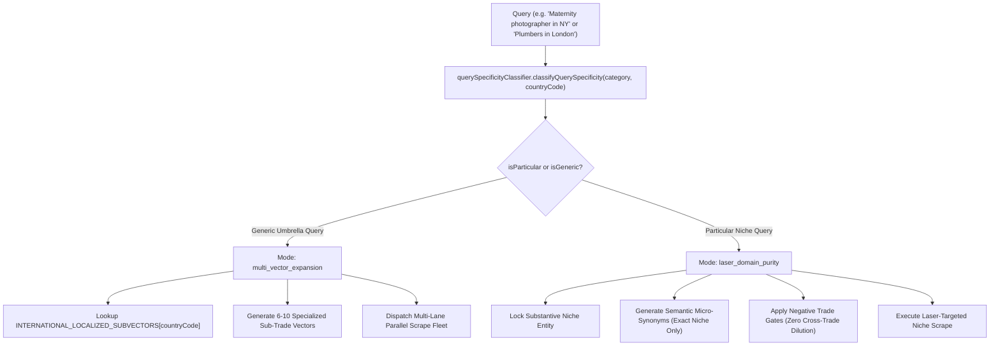

# MASTER IMPLEMENTATION PLAN: Country-Specific Search Expansion & Generic vs. Particular Query Intelligence Engine

**System:** Scraper Fleet Engine v2.5 (Global Multi-Country Intelligence Architecture)  
**Target:** Specially designed, country-localized search expansion reflecting how operators and customers actually search in each specific country (India, US, UK, Canada, Australia, UAE, Germany, France, Global), combined with deterministic Generic vs. Particular query classification and Laser Domain Purity preservation.  
**Scope:** `server/src/utils/`, `server/src/services/`, `client/src/v2/`, `master/src/v2/`

---

## 1. Executive Summary & Core Philosophy

Search habits, legal credential designations, and trade vocabulary differ drastically across countries. When searching for local vendors or B2B targets:
- In the **UK**, users search for `Solicitors (Conveyancing / Family)`, `Gas Safe Registered Plumbers`, `NICEIC Electricians`, `Estate Agents & Lettings`, and `MOT Testing Garages`.
- In the **US / CA**, users search for `Personal Injury Attorneys`, `CPA (Certified Public Accountants)`, `Licensed 24/7 Plumbers`, `Realtors / Listing Agents`, `HVAC Furnace Repair`, and `Auto Detailing / Ceramic Coating`.
- In **Australia**, users search for `Master Plumbers & Gasfitters`, `Licensed Sparkies`, `Buyer's Advocates`, `Bond Cleaning / End of Lease`, and `Panel Beaters`.
- In the **UAE (Dubai / Abu Dhabi)**, users search for `MEP Contracting Companies`, `Chiller & AC Maintenance`, `Luxury Villa Real Estate Brokers`, `PRO Services & Company Formation`, and `Yacht & Luxury Event Catering`.
- In **India**, users search for `Kalyana Mandapams / Function Halls`, `Pure Veg Brahmin Caterers / Biryani Caterers`, `Candid Wedding Photography / Photo Studios`, `Advocates / High Court Lawyers`, `Chartered Accountants (CA)`, and `TMT Steel Dealers / Mandi Wholesalers`.

Furthermore, search intent falls into two distinct operational modes:
1. **Generic Umbrella Queries (Broad Discovery):** e.g. "Photographers", "Lawyers", "Plumbers", "Caterers", "Dentists".
   - *Strategy:* Multi-Vector Expansion decomposing into 6–10 country-tailored sub-sectors.
2. **Particular / Specific Queries (Laser Intent):** e.g. "Maternity photographer", "Divorce lawyer", "Root canal dentist", "Emergency 24/7 plumber", "Brahmin wedding caterer".
   - *Strategy:* **Laser Domain Purity.** Lock the trade entity, generate only semantic micro-synonyms within that exact niche, and prevent cross-subservice dilution (no passport labs for maternity shoots; no patent law for divorce lawyers).

---

## 2. Country-Specific Search Lexicon & Cultural Nuance Grid

| Country | Sector | Local Customer & Trade Search Habits | High-Yield Search Vectors & Credential Anchors |
|---|---|---|---|
| **India (`IN`)** | Weddings & Events | Kalyana Mandapams, AC Function Halls, Marriage Lawns, Shamiana & Sound, Flower Decoration, Mehendi Artists | • Kalyana Mandapams & AC Function Halls • Stage & Flower Event Decorators • Tent House, Sound & Shamiana Rentals • Mehendi & Bridal Makeup Artists |
| **India (`IN`)** | Catering & Food | Pure Veg Brahmin Caterers, Non-Veg Biryani Catering, South Indian Meals, Live Chaat Counter, Sweets Caterers | • Pure Veg Brahmin Wedding Caterers • Hyderabadi Biryani & Non-Veg Caterers • Traditional South Indian Meals & Tiffin • Live Chaat & Sweet Counter Caterers |
| **India (`IN`)** | Photography | Photo Studio, Candid Wedding Photography, Pre Wedding Photoshoot, Digital Color Lab, Passport Size Photos | • Candid Wedding & Reception Photographers • Pre-Wedding & Outdoor Couple Shoots • Just Born & Newborn Baby Photoshoots • Maternity & Baby Shower Photographers • Photo Studios & Digital Labs |
| **India (`IN`)** | Healthcare | Multispeciality Hospitals, Jan Aushadhi Medical, Ayurvedic & Homeo Clinics, Diagnostic Centers & Scanning | • Multispeciality Hospitals & Trauma Centers • Jan Aushadhi & Pharmacy Stores • Diagnostic Centers, Blood Test & Ultrasound • Dental Hospitals & Implant Centers |
| **India (`IN`)** | Legal & Finance | Advocate / High Court Lawyer, Civil & Criminal Advocate, Chartered Accountant (CA), GST & Tax Consultant | • High Court & District Court Advocates • Civil & Criminal Defense Advocates • Chartered Accountants (CA) & Tax Consultants • GST & Income Tax Advisory Firms |
| **India (`IN`)** | Industry & Trade | Mandi Wholesale, Kirana Wholesaler, TMT Steel Dealer, Saree Showroom, Borewell Drilling, Two-Wheeler Garage | • TMT Steel, Cement & Building Materials • Wholesale Mandi & Grain Merchants • Saree Showrooms & Textile Wholesalers • Borewell Drilling & Submersible Pumps |
| **United States (`US`)** | Legal & Law | Personal Injury Attorney, Divorce & Family Lawyer, Criminal Defense Attorney, Real Estate Closing, Estate Planning | • Personal Injury & Accident Lawyers • Family Law & Divorce Attorneys • Criminal Defense & DUI Attorneys • Real Estate & Closing Lawyers • Corporate & Employment Law Firms |
| **United States (`US`)** | Home & Trades | General Contractor, Licensed 24/7 Plumber, HVAC & Furnace Repair, Roofing & Storm Damage, Electrician 200A Panel | • Licensed 24/7 Emergency Plumbers • HVAC Installation & Furnace Repair • Roofing Replacement & Storm Tarping • Licensed Electrical & EV Charger Setup • Kitchen & Bathroom Remodeling Contractors |
| **United States (`US`)** | Real Estate | Realtors, Listing Agent, Buyer's Agent, HOA Property Management, Commercial Real Estate, Title Companies | • Residential Real Estate Agents & Realtors • Commercial Real Estate & Industrial Brokers • Property Management & HOA Services • Luxury Waterfront Real Estate Specialists |
| **United States (`US`)** | Auto & Detailing | Auto Repair Shops, Mobile Detailing, Ceramic Coating & PPF, Transmission Repair, Collision Centers, Towing | • Mobile Auto Detailing & Interior Shampoo • Ceramic Coating & Paint Protection Film (PPF) • Certified Auto Repair Shops & Mechanics • Collision Repair & Auto Body Painting |
| **United States (`US`)** | Healthcare | Urgent Care Walk-In, Family Practice, Invisalign Dentist, Pediatrician, Med Spa & Botox, Physical Therapy | • Urgent Care & Walk-In Medical Clinics • Family Practice & Internal Medicine • Dental Implants & Invisalign Dentists • Med Spas, Botox & Cosmetic Laser Clinics |
| **United Kingdom (`GB`)** | Legal & Property | Solicitors (Conveyancing, Family, Probate, PI), Estate Agents & Lettings, Chartered Surveyors (RICS) | • Solicitors & Conveyancing Legal Practices • Family Law & Divorce Solicitors • Estate Agents & Lettings Agencies • Chartered Surveyors & Property Valuers |
| **United Kingdom (`GB`)** | Trades & Heating | Gas Safe Registered Plumbers, Central Heating & Boiler Repair, NICEIC Electricians, Builders & Joiners, Chimney | • Gas Safe Registered Plumbers • Boiler Installation & Central Heating Engineers • NICEIC Approved Electrical Contractors • Builders, Joiners & Loft Conversions • Roofing Contractors & Chimney Repairs |
| **United Kingdom (`GB`)** | Auto & Garages | MOT Testing Centres, Garages & Servicing, Mobile Tyre Fitting, Accident Repair & Bodywork | • MOT Testing Centres & Service Garages • Car Servicing, Brakes & Diagnostics • Mobile Tyre Fitting & Wheel Tracking • Bodywork & Accident Repair Workshops |
| **Australia (`AU`)** | Trades & Home | Master Plumbers & Gasfitters, Licensed Sparkies, Ducted AC Specialists, Colorbond Roofing, Pest Control | • Master Plumbers & Gasfitters • Licensed Sparkies & Solar Installers • Ducted Air Conditioning Specialists • Colorbond Roofing & Gutter Restoration |
| **Australia (`AU`)** | Real Estate & Services | Real Estate Agents, Buyer's Advocates, Strata Management, Bond Cleaning / End of Lease Cleaning | • Real Estate Agents & Property Managers • Buyer's Advocates & Auctioneers • Bond Cleaning & End of Lease Cleaners • Strata & Commercial Cleaning Services |
| **Australia (`AU`)** | Auto | Panel Beaters, Smash Repairs, Auto Mechanics, Logbook Servicing, 4x4 Accessories | • Panel Beaters & Smash Repairs • Auto Mechanics & Logbook Servicing • Mobile Roadside & Tyre Services |
| **United Arab Emirates (`AE`)** | Engineering & Home | MEP Contracting Companies, Chiller & AC Maintenance, Fit-out Contractors, Sanitary Maintenance | • MEP Contracting Companies • Chiller & AC Duct Cleaning Services • Commercial Fit-out & Interior Contracting • Sanitary & Plumbing Maintenance |
| **United Arab Emirates (`AE`)** | Luxury & Corporate | Luxury Villa Real Estate Brokers, PRO Services & Company Formation, Yacht Catering, Luxury Auto PPF | • Luxury Villa Real Estate Brokers • PRO Services & Freezone Company Formation • Yacht Catering & Luxury Event Planners • Exotic Car Detailing, PPF & Ceramic Coating |
| **Canada (`CA`)** | Trades & Legal | Red Seal Plumbers & Electricians, HVAC & Furnace Repair, Snow Removal, Barristers & Solicitors, Realtors | • Licensed Red Seal Plumbers & Drain Cleaning • Furnace Repair & Heat Pump Installers • Barristers, Solicitors & Personal Injury Lawyers • Residential Realtors & Brokerages |
| **Germany (`DE`)** | Handwerk & Recht | Meisterbetrieb Sanitär & Heizung, Elektroinstallateur Meisterbetrieb, Kfz-Werkstatt, Rechtsanwalt, Notar | • Sanitär- und Heizungsbau Meisterbetrieb • Elektroinstallateur Meisterbetrieb & Wallbox • Kfz-Werkstatt, Inspektion & TÜV Service • Rechtsanwaltskanzlei & Fachanwälte |
| **France (`FR`)** | Artisanat & Droit | Artisan Plombier Chauffagiste Certifié, Électricien Certifié, Garage Automobile, Cabinet d'Avocats, Traiteur | • Artisan Plombier Chauffagiste Certifié • Électricien Certifié & Dépannage 24/7 • Garage Automobile & Mécanique Générale • Cabinet d'Avocats & Droit de la Famille |

---

## 3. Generic vs. Particular Query Architecture

### 3.1 Classification Criteria
A query is classified as **Particular / Specific** (`isParticular: true`) if:
1. It contains a registered **Niche Discriminator Token** (e.g., `newborn`, `maternity`, `just born`, `candid`, `pre wedding`, `drone`, `root canal`, `invisalign`, `implant`, `personal injury`, `divorce`, `criminal defense`, `emergency`, `24/7`, `drain cleaning`, `gas safe`, `brahmin`, `halal`, `ceramic coating`, `ppf`, `crossfit`).
2. It contains a registered trade qualification / credential (e.g., `gas safe`, `cpa`, `red seal`, `niceic`, `bjj`, `mot`).
3. It matches a designated niche in `SPECIFIC_NICHES`.

Otherwise, if it matches an umbrella trade term (e.g., `photographers`, `plumbers`, `lawyers`, `caterers`, `dentists`, `mechanics`, `gyms`, `salons`, `realtors`), it is classified as **Generic Umbrella** (`isGeneric: true`).

### 3.2 Laser Domain Purity Rules (Zero Dilution)
When `isParticular === true`:
- **Photography:** Query "Maternity photographer" produces ONLY:
  - `[City] Maternity Photoshoot Studios`
  - `[City] Pregnancy & Baby Bump Shoots`
  - `[City] Outdoor Maternity Photographers`
  - `[City] Maternity & Newborn Combined Portrait Studios`
  - **Forbidden:** Passport labs, commercial product photography, drone cinematography, corporate headshots.
- **Dental:** Query "Root canal dentist" produces ONLY:
  - `[City] Root Canal Specialists (Endodontics)`
  - `[City] Emergency Root Canal Pain Relief Clinics`
  - `[City] Endodontic Therapy & Tooth Preservation`
  - **Forbidden:** Teeth whitening, Invisalign aligners, pediatric baby teeth clinics.
- **Legal:** Query "Divorce lawyer" produces ONLY:
  - `[City] Divorce & Family Law Attorneys`
  - `[City] Child Custody & Spousal Support Lawyers`
  - `[City] Contested & Uncontested Divorce Lawyers`
  - **Forbidden:** Intellectual property, corporate mergers, tax defense.
- **Plumbing:** Query "Emergency 24/7 plumber" produces ONLY:
  - `[City] 24/7 Emergency Plumbers`
  - `[City] After-Hours Emergency Callout Plumbers`
  - `[City] Burst Pipe & Flooding Rapid Repair Plumbers`
  - **Forbidden:** Bathroom tiling, kitchen cabinet installation.
- **Catering:** Query "Brahmin wedding caterer" produces ONLY:
  - `[City] Traditional Brahmin Wedding Caterers`
  - `[City] Pure Vegetarian Wedding Feast Caterers`
  - `[City] Authentic South Indian Brahmin Catering Services`
  - **Forbidden:** Non-veg biryani, food trucks, BBQ smokers.

---

## 4. Technical File Modification Plan

### File 1: `server/src/utils/querySpecificityClassifier.js` (NEW)
- Core classifier function: `classifyQuerySpecificity(category, countryCode)`.
- Returns `{ isGeneric, isParticular, categoryKey, countryCode, mode, nicheKey, microSynonyms }`.
- Maintains exhaustive lists of particular discriminator tokens across all 20+ commercial sectors.
- Maintains laser-purity micro-synonyms generator for every identified niche.

### File 2: `server/src/utils/indiaTradeIntelligence.js` (EXPANSION)
- Enhance `INTERNATIONAL_LOCALIZED_SUBVECTORS` to include complete sectoral dictionaries for US, GB, CA, AU, AE, DE, FR, and global fallback.
- Update `getSubvectorsForQuery(query, countryCode)`:
  - Call `classifyQuerySpecificity(query, countryCode)`.
  - If `isParticular === true`, return the laser-purity micro-synonyms for that niche.
  - If `isGeneric === true`, return the country-localized multi-vectors.

### File 3: `server/src/utils/universalGeoCluster.js` (INTEGRATION)
- Update `buildCategorySubVectorZones` and `getUniversalCategoryVectors`:
  - Integrate `classifyQuerySpecificity`.
  - In laser purity mode, distribute zones across geographical clusters using the niche's micro-synonyms without umbrella sub-services.
  - In generic mode, distribute zones across the country's multi-vectors.

### File 4: `server/src/services/categoryRouter.js` (PIPELINE WIRING)
- Integrate `classifyQuerySpecificity` in `classifyCategory`.
- Attach specificity metadata (`{ isGeneric, isParticular, mode, subVectors }`) into the returned routing plan.

---

## 5. Automated Verification Test Suite

Ten benchmark scenarios verifying country accuracy and domain purity:
1. `Photographers in New York` (US) -> Generic Umbrella (8 US-localized vectors; no Indian POIs).
2. `Maternity photographer in New York` (US) -> Particular Niche (Domain Purity; 0 passport/commercial).
3. `Plumbers in London` (GB) -> Generic Umbrella (6 GB-localized vectors: Gas Safe, Emergency, Boiler).
4. `Emergency 24/7 plumber in London` (GB) -> Particular Niche (Domain Purity; 0 remodeling/tiling).
5. `Lawyers in Toronto` (CA) -> Generic Umbrella (6 CA-localized vectors: PI, Family, Real Estate).
6. `Divorce lawyer in Toronto` (CA) -> Particular Niche (Domain Purity; 0 corporate/tax).
7. `Catering in Vijayawada` (IN) -> Generic Umbrella (8 IN-localized vectors: Brahmin, Biryani, Meals).
8. `Brahmin wedding caterers in Vijayawada` (IN) -> Particular Niche (Domain Purity; 0 non-veg/fast food).
9. `Dentists in Sydney` (AU) -> Generic Umbrella (6 AU-localized vectors: Family, Implants, Ortho).
10. `Root canal dentist in Sydney` (AU) -> Particular Niche (Domain Purity; 0 whitening/braces).
