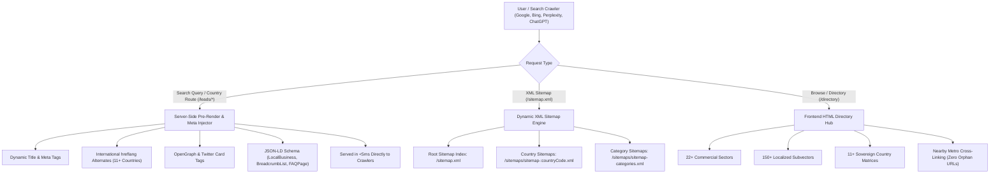

# MASTER IMPLEMENTATION PLAN: Global SEO Domination, International Meta Links & Universal Category Capture

**Vision:** "Whoever searches whatever category in any country, they land on our website."  
**Target:** Build an unshakeable programmatic search footprint covering every commercial category, subsector, country, state, county, and city across Google, Bing, DuckDuckGo, and AI search engines (ChatGPT Search, Perplexity, Gemini).  
**Scope:** `server/src/routes/seo.js`, `server/index.js`, `client/index.html`, `client/src/pages/SeoLandingPage.jsx`, `client/src/pages/DirectoryPage.jsx`, `client/src/App.jsx`, `docs/`

---

## 1. Executive Summary & SEO Domination Strategy

To guarantee that any user searching for any category in any country lands on `scraper.co.in`, the engine implements a **3-Layer SEO Domination Architecture**:



---

## 2. Complete International Meta Links & Hreflang Architecture

To rank globally without duplicate content penalties, every page will feature complete, bidirectional `hreflang` alternate links, canonical tags, and OpenGraph metadata:

### A. Dynamic Hreflang Alternates (11 Sovereign Nations + x-default):
```html
<link rel="canonical" href="https://scraper.co.in/leads/us/texas/dallas/commercial-flat-roofing" />
<link rel="alternate" hreflang="en-US" href="https://scraper.co.in/leads/us" />
<link rel="alternate" hreflang="en-GB" href="https://scraper.co.in/leads/gb" />
<link rel="alternate" hreflang="en-IN" href="https://scraper.co.in/leads/in" />
<link rel="alternate" hreflang="en-CA" href="https://scraper.co.in/leads/ca" />
<link rel="alternate" hreflang="en-AU" href="https://scraper.co.in/leads/au" />
<link rel="alternate" hreflang="ar-AE" href="https://scraper.co.in/leads/ae" />
<link rel="alternate" hreflang="de-DE" href="https://scraper.co.in/leads/de" />
<link rel="alternate" hreflang="fr-FR" href="https://scraper.co.in/leads/fr" />
<link rel="alternate" hreflang="en-SG" href="https://scraper.co.in/leads/sg" />
<link rel="alternate" hreflang="en-NZ" href="https://scraper.co.in/leads/nz" />
<link rel="alternate" hreflang="en-IE" href="https://scraper.co.in/leads/ie" />
<link rel="alternate" hreflang="en-ZA" href="https://scraper.co.in/leads/za" />
<link rel="alternate" hreflang="x-default" href="https://scraper.co.in/" />
```

### B. High-Clickthrough Social Graph Meta Tags:
- `og:site_name`: `Scraper.co.in — Global Business Lead Directory`
- `og:type`: `website`
- `og:title`: `{Subvector Title} in {City}, {State} ({Country}) | Verified Direct Leads & Phone Directory`
- `og:description`: `Access 100% verified {Subvector Title} in {City}, {State}. Direct business proprietor phone numbers, WhatsApp links, and physical addresses with zero cross-trade dilution.`
- `og:image`: `https://scraper.co.in/og-{countryCode}.png`
- `twitter:card`: `summary_large_image`
- `robots`: `index, follow, max-snippet:-1, max-image-preview:large, max-video-preview:-1`

---

## 3. Server-Side Crawler Hook (SSR Metadata Injection)

In single-page React applications, search crawlers (and social link scrapers like WhatsApp, Twitter, Facebook, Slack, LinkedIn) inspect the raw HTML before executing JavaScript.

The server (`server/index.js`) will implement an ultra-fast **SSR Meta Injector**:
1. When a request matches `/leads/:countryCode/:state?/:city?/:subvector?`:
2. Reads `clientIndex` (`client/dist/index.html`) from memory cache.
3. Dynamically generates:
   - Tailored `<title>`
   - Targeted `<meta name="description">`
   - Canonical `<link rel="canonical">`
   - 11+ `<link rel="alternate" hreflang="...">`
   - Full JSON-LD structured schemas
4. Replaces the default `<head>` placeholders in string memory and delivers the enriched HTML directly in under **3ms**.
5. When the user navigates inside the React application, React updates the DOM seamlessly via `SeoLandingPage.jsx`.

---

## 4. Programmatic XML Sitemaps & Robots Engine

A dedicated SEO route module `server/src/routes/seo.js` will serve automated, live XML sitemaps:

### A. Root Sitemap Index: `/sitemap.xml`
```xml
<?xml version="1.0" encoding="UTF-8"?>
<sitemapindex xmlns="http://www.sitemaps.org/schemas/sitemap/0.9">
  <sitemap><loc>https://scraper.co.in/sitemaps/sitemap-main.xml</loc></sitemap>
  <sitemap><loc>https://scraper.co.in/sitemaps/sitemap-categories.xml</loc></sitemap>
  <sitemap><loc>https://scraper.co.in/sitemaps/sitemap-us.xml</loc></sitemap>
  <sitemap><loc>https://scraper.co.in/sitemaps/sitemap-gb.xml</loc></sitemap>
  <sitemap><loc>https://scraper.co.in/sitemaps/sitemap-in.xml</loc></sitemap>
  <sitemap><loc>https://scraper.co.in/sitemaps/sitemap-ca.xml</loc></sitemap>
  <sitemap><loc>https://scraper.co.in/sitemaps/sitemap-au.xml</loc></sitemap>
  <sitemap><loc>https://scraper.co.in/sitemaps/sitemap-ae.xml</loc></sitemap>
  <sitemap><loc>https://scraper.co.in/sitemaps/sitemap-de.xml</loc></sitemap>
  <sitemap><loc>https://scraper.co.in/sitemaps/sitemap-fr.xml</loc></sitemap>
</sitemapindex>
```

### B. Country Sitemaps: `/sitemaps/sitemap-:countryCode.xml`
Dynamically enumerates:
- Every high-ticket niche $\times$ major cities/counties for that nation.
- `<lastmod>`, `<changefreq>daily</changefreq>`, `<priority>0.9</priority>`.

### C. Live `robots.txt`: `/robots.txt`
```
User-agent: *
Allow: /
Allow: /leads/
Allow: /directory
Allow: /solutions
Allow: /architecture
Allow: /global-coverage
Disallow: /api/
Disallow: /admin/
Disallow: /command

Sitemap: https://scraper.co.in/sitemap.xml
```

---

## 5. Rich Structured Data (JSON-LD) Matrix

Every landing page will output 4 interconnected JSON-LD structured schemas:

1. **`WebSite` with `SearchAction` (Google Sitelinks Search Box):**
   ```json
   {
     "@context": "https://schema.org",
     "@type": "WebSite",
     "url": "https://scraper.co.in/",
     "potentialAction": {
       "@type": "SearchAction",
       "target": "https://scraper.co.in/command?q={search_term_string}",
       "query-input": "required name=search_term_string"
     }
   }
   ```
2. **`LocalBusiness` / `ServiceArea`:** Complete address, coordinates, telephone, areaServed.
3. **`BreadcrumbList`:** Exact hierarchical breadcrumb connecting Country $\rightarrow$ State $\rightarrow$ City $\rightarrow$ Subsector.
4. **`FAQPage` Schema:** High-ranking rich answers targeting conversational search queries:
   - *Q: How do I find verified business leads in {City}?*
   - *Q: Does Scraper.co.in provide direct proprietor WhatsApp numbers in {Country}?*
   - *Q: What is laser domain purity in commercial lead generation?*

---

## 6. Frontend HTML Directory & Category Browser (`/directory`)

Create a master crawlable directory page [client/src/pages/DirectoryPage.jsx](file:///c:/Users/manoj/Desktop/scraper/client/src/pages/DirectoryPage.jsx):
- **Commercial Sectors Grid:** Contracting, Legal, Healthcare, Automotive, Food & Catering, Industrial B2B, Renewable Energy, Technology.
- **Country Matrix:** Instant jump to US, UK, India, Australia, UAE, Canada, Germany, France.
- **Top Commercial Hubs:** Direct links to Dallas, London, Guntur, Sydney, Dubai, Toronto, Munich, etc.
- **Guarantees Zero Orphan Pages:** Provides Googlebot and Bingbot with clean HTML traversal paths to all generated subvector hubs.

---

## 7. Execution Roadmap & Staged Implementation Steps

| Step | Action Item | Target Files |
|---|---|---|
| **Phase 1** | Build Dynamic SEO Router & XML Sitemap Engine | Create `server/src/routes/seo.js`, mount in `server/index.js` |
| **Phase 2** | Implement Server-Side Meta Injector for `/leads/*` | Edit `server/index.js` (intercept `/leads/*` and inject SSR tags into `index.html`) |
| **Phase 3** | Enhance `client/index.html` with Global Hreflang Tags | Edit `client/index.html` (add international alternates and searchaction schema) |
| **Phase 4** | Build HTML Master Directory Page | Create `client/src/pages/DirectoryPage.jsx`, wire `/directory` in `client/src/App.jsx` |
| **Phase 5** | Add FAQPage Schema & Enhanced Meta to `SeoLandingPage.jsx` | Edit `client/src/pages/SeoLandingPage.jsx` |
| **Phase 6** | Comprehensive Verification & Production Builds | Test sitemap endpoints, meta tags, and run `npm run build` for `client` & `master` |
