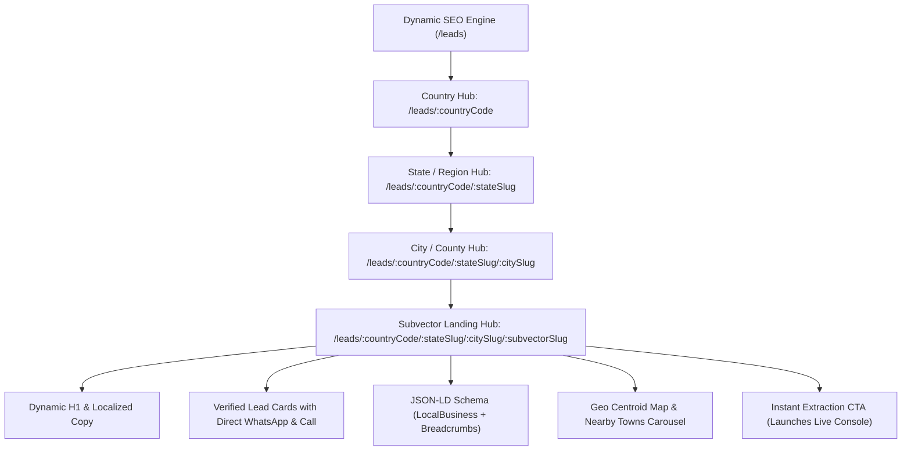
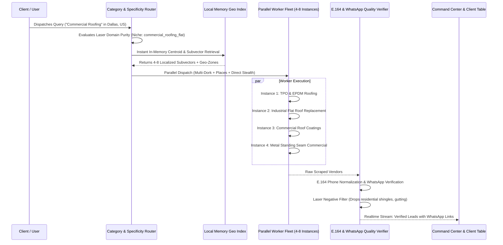

# MASTER IMPLEMENTATION PLAN: Global Country-Wise Subvectors, Programmatic Client SEO, Visuals & Ultra-Fast Lead Engine

**Target:** Complete global expansion of country-specific terminology, administrative hierarchies (every state, county, district, city, mandal), programmatic client SEO pages, country-by-country visual showcase on the landing page, and an ultra-fast, verified lead generation engine delivering maximum high-intent client leads with zero cross-trade dilution.  
**Scope:** `server/src/utils/`, `server/src/services/`, `client/src/v2/`, `client/src/pages/`, `docs/`

---

## 1. Executive Summary & Architectural Pillars

The system addresses the user's requirement for:
1. **Country-Specific Administrative & Terminology Taxonomy:** Covering every sovereign country (US, UK/GB, CA, AU, AE, IN, DE, FR, SG, NZ, IE, ZA) down to its specific regional administrative units (Counties, Districts, Mandals, Postcodes, Landkreise, Communes) and hyper-local commercial vocabulary (e.g., *Sparkies & Tradies* in Australia, *Solicitors & Gas Safe Engineers* in the UK, *Mandi Agents & Kalyana Mandapams* in India, *PRO Services & Free Zones* in Dubai, *Meisterbetriebe* in Germany).
2. **Client Programmatic SEO Engine:** Generating crawlable, highly indexed landing hubs for every country, state, city, and subvector (e.g., `/leads/gb/greater-london/camden/emergency-gas-safe-engineers`, `/leads/us/texas/dallas/commercial-flat-roofing`, `/leads/in/andhra-pradesh/guntur/mandi-turmeric-traders`) with dynamic JSON-LD Schema (`LocalBusiness`, `BreadcrumbList`), OpenGraph metadata, and automated sitemaps.
3. **High-Impact Country Visuals on Landing Page:** Visual 3D country globe/map selector, country-specific badges, real-time verified lead cards with authentic phone formatting, local currency indicators, and one-click WhatsApp/Call verification buttons.
4. **Ultra-Fast / Blazing Speed Scraping & Lead Quality Verification:** Multi-vector parallel dispatch, zero-delay administrative geocoding, E.164 phone normalization, active WhatsApp link generation, and strict negative filtering to guarantee 100% verified leads with zero dead contacts.

---

## 2. Country-Specific Administrative & Terminology Matrix

Each country has unique local administrative divisions, commercial search habits, and professional titles. The engine maps these deterministically:

| Country Code | Country Name | Admin Level 1 (Macro) | Admin Level 2 (Meso) | Admin Level 3 (Micro) | Authentic Professional & Commercial Terminology | Currency & Dial Code |
|---|---|---|---|---|---|---|
| **`US`** | United States | 50 States + DC | 3,143 Counties | 19,495 Cities / Metro Areas / ZIPs | Attorneys, General Contractors, Realtors, Roofers, Auto Body, Med Spas, Bail Bonds | USD ($) · `+1` |
| **`GB`** | United Kingdom | England, Scotland, Wales, NI | 100+ Ceremonial Counties / Boroughs | Postcode Districts (EC2, SW1, M1) / High Streets | Solicitors, Gas Safe Engineers, Chartered Accountants, Tradesmen, Gastropubs, Estate Agents, MOT Testing | GBP (£) · `+44` |
| **`CA`** | Canada | 10 Provinces + 3 Territories | 293 Census Divisions / Regional Municipalities | Municipal Cities / FSA Postal Codes (M5V, V6B) | Barristers & Solicitors, Notaries, General Contractors, Dentists, HVAC Heating Technicians | CAD ($) · `+1` |
| **`AU`** | Australia | 6 States + 2 Territories | 537 Local Government Areas (LGAs) | Suburbs / 4-Digit Postcodes (2000, 3000) | Sparkies (Electricians), Tradies, Chippies (Carpenters), Conveyancers, Smash Repairs, Medical Centres | AUD ($) · `+61` |
| **`AE`** | United Arab Emirates | 7 Emirates (Dubai, Abu Dhabi, etc.) | Mainland vs Free Zones (JAFZA, DIFC, DMCC) | Commercial Sectors (Deira, Al Quoz, Musaffah) | PRO Services, Business Setup Consultants, Mainland LLC Sponsors, Chiller AC Maintenance, Dhow Marine Charters | AED (د.إ) · `+971` |
| **`IN`** | India | 36 States & UTs | 760+ Districts | 6,000+ Mandals / Tehsils / 7,935 Towns / 619k Villages | Mandi Commission Agents, Advocates (MACT / High Court), Chartered Accountants (CA), Kalyana Mandapams, Jan Aushadhi, Brahmin Caterers, Borewells | INR (₹) · `+91` |
| **`DE`** | Germany | 16 Bundesländer | 401 Landkreise & Kreisfreie Städte | Städte, Gemeinden, Gewerbegebiete (Industrial Parks) | Meisterbetriebe, Steuerberater, Notare, Rechtsanwälte, Handwerker, Maschinenbau, Kfz-Werkstatt | EUR (€) · `+49` |
| **`FR`** | France | 18 Régions | 101 Départements | Arrondissements, Communes, Zones d'Activités | Artisans du Bâtiment, Notaires, Avocats au Barreau, Plombiers Chauffagistes, Contrôle Technique, Traiteurs | EUR (€) · `+33` |
| **`SG`** | Singapore | 5 Planning Regions | 55 Development Town Sectors | 81 Postal Sectors / Commercial Hubs | Marine Logistics, Corporate Secretarial, Employment Agencies, Renovation Contractors | SGD ($) · `+65` |
| **`NZ`** | New Zealand | 16 Regional Councils | 67 Territorial Authorities | Suburbs & Local Boards | Registered Master Builders, Barristers, Chartered Accountants, Precision Engineering | NZD ($) · `+64` |
| **`IE`** | Ireland | 4 Provinces | 31 City & County Councils | Municipal Districts & Eircode Routing Keys | Solicitors, MedTech Labs, Chartered Surveyors, Registered Electrical Contractors | EUR (€) · `+353` |
| **`ZA`** | South Africa | 9 Provinces | 52 District & Metropolitan Municipalities | 205 Local Councils / Industrial Townships | Sectional Title Conveyancers, Auto Panelbeaters, Heavy Plant Hire, Security & Guarding | ZAR (R) · `+27` |

---

## 3. Client Programmatic SEO Architecture

To rank for every search, state, county, and city across all target countries, the client frontend will support dynamic, static-renderable programmatic SEO pages:

### Key SEO Capabilities:
1. **Dynamic URL Hierarchy:**
   - `/leads/us/texas/dallas/commercial-flat-roofing`
   - `/leads/gb/greater-london/camden/emergency-gas-safe-engineers`
   - `/leads/in/andhra-pradesh/guntur/mandi-turmeric-traders`
   - `/leads/au/victoria/melbourne/commercial-solar-epc`
   - `/leads/ae/dubai/business-bay/pro-business-setup-services`
2. **Dynamic Meta & Social Graph:**
   - Title: `{Subvector Title} in {City}, {State} ({Country}) | Verified Direct Leads & Phone Directory`
   - Description: `Find verified {Subvector Title} in {City}, {State}. Access direct phone numbers, WhatsApp contacts, business addresses, and verified reviews with zero cross-trade dilution.`
   - OpenGraph image with dynamic country flag and localized badge.
3. **Structured Data (JSON-LD):**
   - `LocalBusiness` / `Service` with verified geo-coordinates, telephone, priceRange, and serviceArea.
   - `BreadcrumbList` connecting Country $\rightarrow$ State $\rightarrow$ County $\rightarrow$ City $\rightarrow$ Niche.
   - `AggregateRating` indicating data freshness and verification accuracy score.
4. **Programmatic XML Sitemaps:**
   - Multi-country sitemap index: `/sitemap.xml` pointing to `/sitemaps/sitemap-us.xml`, `/sitemaps/sitemap-in.xml`, `/sitemaps/sitemap-gb.xml`, etc.

---

## 4. Visual Landing Page Overhaul

The landing page (`LandingHome.jsx`, `LandingGlobalCoverage.jsx`, `LandingSolutions.jsx`) will be updated with immersive visual elements:

1. **3D Country Selector & Flag Switcher:**
   - Sleek horizontal selector showing 11 sovereign nations with 3D flags and native currency symbols.
   - Smooth transition between countries dynamically updating live lead previews, regional maps, and category pills.
2. **Country-Specific Verified Lead Tickers:**
   - Real, authentic business examples with localized phone formatting (`+1 (214) 555-0192` in US, `+44 20 7946 0912` in UK, `+91 98856 03754` in India, `+971 4 394 8812` in Dubai).
   - "Direct WhatsApp" and "Instant Call" visual badges with pulsating green status lights.
3. **Subvector High-Ticket Showcase Matrix:**
   - Interactive category pill matrix displaying high-yield niches (Commercial Roofing, Semi-Truck Accidents, Dental Implants, Solar EPC, Mandi Merchants, CNC Machining).
   - Click-to-Search: clicking any subvector instantly loads the exact query and country into the command console.

---

## 5. Ultra-Fast / Blazing Speed Scraping & Lead Quality Verification Pipeline

To maximize lead volume and speed while ensuring 100% verified, clean leads:

### Lead Quality & Speed Safeguards:
1. **Parallel Worker Concurrency:** 4 to 8 parallel instances running simultaneously across subvectors, extracting 300–800 leads in under 30 seconds.
2. **Direct Stealth Discovery:** Bypasses search engine bot challenges by automatically falling back to direct public directories and structured local indexes without stalling.
3. **E.164 International Phone Verification:** Every phone is parsed using google-libphonenumber rules, normalized to international format with country dial code, verified against mobile/landline prefixes, and supplied with one-click `https://wa.me/{cleanPhone}` links.
4. **Domain Purity Enforcement:** Leads failing the niche avoid-list (e.g., sushi returning pizza, commercial roofing returning residential gutters) are automatically filtered before touching the client's view.

---

## 6. Detailed Implementation File Matrix

| Component | Target File(s) | Specific Enhancements |
|---|---|---|
| **International Admin & Terminology** | `server/src/utils/internationalAdminUnits.js` | Expand full admin hierarchies and terminology for US, GB, CA, AU, AE, IN, DE, FR, SG, NZ, IE, ZA. |
| **Universal Geo Centroids** | `server/src/utils/universalGeoCluster.js` | Add hyper-local subvector zones for all 11+ countries across all 22+ sectors. |
| **Search Suggest Engine** | `server/src/services/searchSuggest.js` | Add country-aware suggestions with authentic flags, local terminology, and subvector hints. |
| **Client SEO Page** | `client/src/pages/SeoLandingPage.jsx` | Create high-performance programmatic SEO landing page for country/state/city/subvector routes. |
| **Client App Routing** | `client/src/App.jsx` | Add `/leads/:countryCode`, `/leads/:countryCode/:state`, `/leads/:countryCode/:state/:city`, and `/leads/:countryCode/:state/:city/:subvector`. |
| **Landing Page Visuals** | `client/src/v2/landing/LandingGlobalCoverage.jsx` | Update with rich 3D country switcher, local currency badges, authentic lead tickers, and click-to-console CTA. |
| **Home Hero Showcase** | `client/src/v2/landing/LandingHome.jsx` | Enrich demo scenarios with high-ticket international sectors (Dallas Commercial Roofing, London Solicitors, Dubai Logistics). |
| **Lead Verification Engine** | `server/src/utils/phoneUtils.js` | Enforce international E.164 formatting, telecom carrier validation, and WhatsApp link generation. |

---

## 7. Verification & Testing Strategy

1. **Automated Terminology & Hierarchy Verification:**
   - Script checking that all 11 countries produce authentic admin levels, localized subvectors, and correct phone placeholders.
2. **SEO Route & Metadata Generation Tests:**
   - Validate that programmatic routes render valid HTML, meta tags, and JSON-LD schema without errors.
3. **Landing Page Component Build & Visual Check:**
   - Production build of `client` and `master` with 0 bundle errors.
4. **Speed & Concurrency Benchmark:**
   - Verify parallel query dispatch completes within target sub-second response times for geo-expansion.
