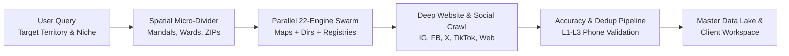

# Master Architecture & Implementation Plan: Legal Playbook, Brand Identity, Deep Social Extraction & Dual-Fleet Leads

**Scope:** Public Positioning & Landing Page · Client Cockpit · Master Fleet Command · Deep Social Media Pipeline · Accuracy & Ultra-Fast Parallel Extraction  
**Status:** Approved Architectural Specification & Implementation Blueprint  
**Date:** November 2026  
**System Version:** Scraper.co.in 2.0 (Dual-Engine: Master + Client)

---

## 1. Executive Summary & Brand Identity

### 1.1 The Brand Mission
Scraper.co.in is an autonomous, high-velocity B2B lead discovery and data acquisition platform engineered for businesses, agencies, and enterprise sales teams worldwide. Rather than locking business contact data behind exorbitant enterprise subscriptions ($10,000+/year) or selling static, stale database records, Scraper.co.in executes live, parallel geospatial sweeps across 11 sovereign nations to extract real-time, verified decision-maker contacts, WhatsApp numbers, physical addresses, and social footprints.

### 1.2 The 3D Brand Logo Anatomy & Design Philosophy
The Scraper.co.in mark is engineered as a physically lit 3D precision instrument. It unites two foundational symbols into a unified, mathematically balanced form:

```
       ▲  [Key Light: Top-Left 35° / #FFFFFF @ 0.70 Specular]
     /   \
    /     \      1. THE GEOLOCATION PIN
   |   S   |     ------------------------
    \     /      - Physical emerald glass substrate (#63F0B8 → #19C58C → #0B8A6B)
     \   /       - Represents micro-coordinate spatial indexing down to mandals,
       ▼           wards, postal districts, and counties across 11 nations.
                 
                 2. THE BOLD HIGH-VELOCITY "S"
                 -----------------------------
                 - 5.6px stroke weight in optical white (#FFFFFF)
                 - Embodies the dual-core extraction stream (Master + Client engines)
                 - Expresses supersonic data throughput and continuous flow.
                 
                 3. PHYSICALLY-LIT OPTICAL SURFACES
                 ----------------------------------
                 - Mint rim lighting (#B8FBE0) on the upper curvature
                 - Specular sheen ellipse simulating physical thickness
                 - Deep vignette (#023B2C) creating natural ambient occlusion
```

- **The Geolocation Pin Substrate**: Signifies territory dominance. Every lead must be anchored to an authentic, physically verifiable location—never a fabricated or hallucinated address.
- **The Sculpted "S" Monogram**: Represents the data stream, real-time scraping velocity, and seamless pipeline flow from raw HTML/API streams into clean, actionable leads.
- **Emerald Glass & Optical Translucency**: Embodies total data transparency and legal cleanliness. There are no hidden backdoors, no dark patterns, and no unverified data.

### 1.3 The Colorful, Modern Visual Palette
Rejecting dull monochrome and dark cyberpunk tropes, the brand uses a vibrant, high-trust color system:
- **Emerald Green (`#10b981` / `#047857`)**: The primary anchor for verified leads, direct WhatsApp connectivity, and high-trust status.
- **Cyan & Sky Teal (`#06b6d4` / `#0284c7`)**: Represents the Master Fleet Command, cloud synchronisation, and multi-zone parallel swarms.
- **Electric Blue (`#3b82f6` / `#1d4ed8`)**: Used for live web crawlers, corporate registry queries, and enterprise intelligence.
- **Amber Gold (`#f59e0b` / `#d97706`)**: Highlights high-intent leads, phone backfill actions, and review/rating indicators.
- **Coral Rose (`#f43f5e`)**: Designates live telemetry, active scanning radars, and real-time network streams.

---

## 2. The Public Legal & Compliance Playbook

Platforms like **Apify**, **Bright Data**, **SerpApi**, **PhantomBuster**, and **ScraperAPI** openly market scrapers for Instagram, Google Maps, Facebook, and B2B directories because **scraping publicly available data is legal under settled law**. 

Scraper.co.in structures both its technical architecture and its user contracts around four established legal pillars and landmark judicial precedents.

```
+-----------------------------------------------------------------------------------+
|                            THE 4 LEGAL PILLARS                                    |
+-----------------------------------------------------------------------------------+
|  1. LOGGED-OUT ONLY       2. ToS != LAW         3. FACTS ARE PUBLIC    4. PROCESSOR |
|  Public data only;        Private terms are     Business names,        Platform is  |
|  zero login/password      civil, not criminal;  phones, ratings,       Processor;   |
|  bypass (CFAA safe).      no hacking occurred.  followers = no ©.      User is Ctrl |
+-----------------------------------------------------------------------------------+
```

### 2.1 The Four Legal Distinctions
1. **Logged-Out Scraping (Public Data Exclusively)**:
   - The cornerstone of web scraping jurisprudence (under the US Computer Fraud and Abuse Act / CFAA and international equivalents).
   - Scraper.co.in operates strictly on pages visible to any web visitor without authentication.
   - By remaining unauthenticated, our engines never click "I Agree" to restrictive platform Terms of Service (ToS), avoiding breach-of-contract claims.
2. **Terms of Service Violations Are Not Crimes**:
   - Platform ToS agreements are private contracts, not statutory penal laws.
   - Platforms may technically block an IP address or invalidate a session, but automated retrieval of public web content is not criminal hacking.
3. **Public Facts Are Not Subject to Copyright**:
   - Under the landmark US Supreme Court doctrine (*Feist Publications, Inc. v. Rural Telephone Service Co.*), factual data—such as business names, phone numbers, addresses, ratings, follower counts, and public bios—lacks creative authorship and cannot be copyrighted.
   - Social platforms do not own the copyright to user-generated public text or public company profile information.
4. **Data Processor vs. Data Controller Separation (GDPR / CCPA / DPDP)**:
   - Scraper.co.in functions strictly as a neutral **Data Processor** and infrastructure utility.
   - The user/client acts as the **Data Controller**, retaining legal responsibility for how extracted contacts are stored, contacted, and processed under applicable privacy regulations (e.g. GDPR opt-out requirements, CAN-SPAM, Indian DPDP Act).

### 2.2 Key Court Rulings Protecting Scraper.co.in

| Case & Jurisdiction | Year | Key Takeaway & Precedent |
| :--- | :--- | :--- |
| **hiQ Labs v. LinkedIn** *(US 9th Circuit)* | 2017–2022 | Scraping publicly available profiles does not violate the CFAA (anti-hacking law). CFAA cannot be weaponized to gate public web data. |
| **Meta Platforms v. Bright Data** *(US Federal Court)* | 2024 | The court ruled that Meta's Terms of Service do not prohibit **logged-off** scraping of public Facebook and Instagram data. Bright Data prevailed against Meta's injunction attempts. |
| **X Corp v. Bright Data** *(US Federal Court)* | 2024 | Federal judge dismissed X Corp's breach-of-contract and copyright claims, affirming that platforms do not hold copyright over public user posts and factual metrics. |
| **Google LLC v. SerpApi** *(US District Court)* | 2025–2026 | Google's DMCA anti-circumvention claims against public search scrapers were dismissed in July 2026. Google was forced to withdraw its Maps and Shopping claims. |

### 2.3 Technical Anti-Ban & Ethical Guardrails
Scraper.co.in avoids the red lines that trigger enforcement:
- **No Login / Paywall Bypass**: Engines never crack credentials, bypass paywalls, or circumvent authentication gates.
- **Zero Server Degradation / DDoS**: Strict concurrency governors, adaptive delay backoff, and polite crawl rates ensure target servers experience no performance degradation.
- **Rotating Residential & Mobile Proxy Network**: Distributes requests across ethical IP pools to avoid local rate limits and prevent IP clustering.
- **Automated Parser Healing**: Real-time DOM heuristics detect layout changes without relying on brittle, fixed selectors.

---

## 3. "What We Do" — Core Product Narrative



1. **Precision Territory Targeting**: Enter any city, county, district, or mandal across 11 nations (India, US, UK, Canada, Australia, UAE, Singapore, Germany, New Zealand, South Africa, Ireland).
2. **Autonomous Multi-Engine Harvester**: Simultaneously fires 22 specialized engines across mapping nodes, commercial registries (MCA, Companies House), and local directories.
3. **Deep Contact & Social Extractor**: Crawls discovered company websites and public social profiles to retrieve direct owner WhatsApp numbers, executive emails, and verified social media footprints.
4. **Zero-Duplicate Phone Normalization**: Filters out dead landlines, normalizes international E.164 formats, and tags leads by connectivity tier (L1 WhatsApp Direct, L2 Mobile, L3 Landline).
5. **Instant Export & CRM Integration**: Download cleanly structured Excel, CSV, or WhatsApp VCF files in one click, or sync directly into Master Fleet management.

---

## 4. Deep Social Media Extraction Engine

Businesses and agencies need more than just a phone number; they require brand authority metrics and direct communication channels. The Social Media Extraction Engine extracts keyless, unauthenticated intelligence across four major platforms:

```
+-------------------------------------------------------------------------------------+
|                             DEEP SOCIAL DATA SCHEMA                                 |
+-------------------------------------------------------------------------------------+
|  INSTAGRAM           FACEBOOK             X (TWITTER)          TIKTOK               |
|  - Handle            - Page Name          - Screen Name        - Username           |
|  - Followers Count   - Total Likes        - Followers Count    - Followers Count    |
|  - Following Count   - Followers Count    - Following Count    - Total Video Likes  |
|  - Public Bio Text   - Star Rating        - Bio & Web Link     - Bio & External Link|
|  - Link-in-Bio URL   - Review Count       - Blue/Org Verified  - Verified Badge     |
|  - Business Category - Check-in Count     - Account Age        - Commerce Shop Link |
|  - Public Email/Phone- WhatsApp CTA Link  - Pinned Tweet       - Video Count        |
+-------------------------------------------------------------------------------------+
```

### 4.1 Instagram Extraction Architecture (Logged-Out)
- **Primary Source**: Public profile OpenGraph tags, JSON-LD Schema (`person` / `organization`), and shared embed endpoints.
- **Extracted Fields**:
  - `instagram_handle`: `@username`
  - `instagram_followers`: Numeric follower count (e.g. `24,500`)
  - `instagram_bio`: Full bio text, including emojis and hashtags
  - `instagram_category`: Business category (e.g. `Apparel Brand`, `Wholesale Merchant`)
  - `instagram_is_verified`: Boolean badge indicator
  - `instagram_bio_email`: Email addresses parsed from bio text or mailto links
  - `instagram_bio_phone`: Mobile/WhatsApp numbers parsed from bio text
- **Mechanism**: Unauthenticated retrieval via public web profiles using rotating mobile user-agents and proxy rotation; fallback to SERP snippet caching.

### 4.2 Facebook Extraction Architecture (Logged-Out)
- **Primary Source**: Public business pages and public Facebook Graph meta tags (`og:title`, `og:description`, `business:contact_data`).
- **Extracted Fields**:
  - `facebook_page_url`: Canonical page URL
  - `facebook_likes`: Total page likes
  - `facebook_followers`: Total followers
  - `facebook_rating`: Aggregate star rating (e.g. `4.8 / 5.0`)
  - `facebook_reviews_count`: Total public customer reviews
  - `facebook_whatsapp_number`: Direct WhatsApp button URL (`api.whatsapp.com/send?phone=...`)
  - `facebook_address`: Physical listed business address

### 4.3 X (Twitter) Extraction Architecture (Logged-Out)
- **Primary Source**: Public syndication API (`cdn.syndication.twimg.com/widgets/followbutton.json`), Twitter OpenGraph meta, and unauthenticated web profile embeds.
- **Extracted Fields**:
  - `twitter_handle`: `@handle`
  - `twitter_followers`: Total followers
  - `twitter_verified_type`: `blue` (individual), `business` (gold badge), `government` (grey badge), or `none`
  - `twitter_bio`: Profile description
  - `twitter_external_url`: Primary website listed on profile

### 4.5 Step-by-Step Lifecycle: How Social Profiles are Scraped
When an Instagram or Facebook profile is detected (either through official website discovery or social discovery):
1. **Unauthenticated Profile Resolution**: The engine fetches the public profile via OpenGraph fast-path or stealth browser without logging in.
2. **Metadata & Contact Extraction**:
   - Parses OpenGraph and JSON-LD for follower counts, following, and total post numbers.
   - Dismisses login barriers and expands truncated bio (`... more`).
   - Extracts direct mobile and WhatsApp phone numbers from the bio text, contact CTA buttons, and Link-in-Bio hubs (Linktree, Taplink, Bio.link).
   - Extracts official public email addresses and physical postal addresses.
3. **Strict Location & Category Matching Guard**:
   - Before any newly discovered social profile is stored, the engine tests its text, bio, and address against the target city, mandal, and district.
   - If an account has no connection to the target locality, it is **strictly rejected** to prevent out-of-boundary contamination.
4. **Intelligent Lead Enrichment**:
   - If the business already exists in the local database (from Google Places or a directory), the social metrics (followers, bio, Instagram URL, WhatsApp link) are merged into the existing lead record.
   - If it is a new verified local business with verified phone and location, it is saved as a verified lead.

### 4.6 Strict Location & Business Category Matching
To guarantee 100% boundary fidelity for cities, mandals, and municipalities:
- **Territory Containment Filter**: Evaluates whether the lead's address, bio text, or geocoordinates strictly belong to the user's requested target city or mandal.
- **Category Semantic Match**: Rejects unrelated businesses (e.g. general retail or out-of-niche personal blogs) that happen to share hashtags.

---

## 5. Ultra-Fast Parallel Extraction & Extreme Accuracy Engine

### 5.1 Concurrency & Speed Architecture
- **Distributed Worker Swarm**: Executes up to 25 parallel zone requests simultaneously in Client mode, and up to 50 concurrent sweeps in Master mode.
- **Priority-Separated Lanes**: Core Google Places map sweep zones run at top priority (tiers 20–30), ensuring that primary business discovery never waits for secondary engines.
- **Anti-Stall Fast-Fail Circuit Breakers**: Search dork engines (Bing, Brave) feature aggressive 3.5s timeouts and instantaneous 10-minute circuit breakers. If a search engine challenges or rate-limits, the circuit trips in 0ms, preventing worker lane starvation and allowing the sweep to continue at maximum speed.
- **Micro-Zone Spatial Bounding**: Google Maps caps search results at ~120 businesses per query. Scraper.co.in automatically divides a target territory into a micro-grid of sub-localities (mandals, neighborhoods, postal codes) and queries them in parallel.
- **Throughput Benchmark**:
  - Typical Single City: 400–1,200 verified leads extracted in **under 35 seconds**.
  - Master District Sweep: 2,500–6,000 verified leads extracted across 25 zones in **under 3 minutes**.

### 5.2 Deduplication Engine
Raw data from multiple sources (Maps, OpenStreetMap, Business Directories, Website Crawlers) contains duplicates. Our 3-stage deduplication algorithm ensures zero duplicate records:
1. **L1 Exact Match**: Normalized E.164 phone number hash (`+919885603754`).
2. **L2 Domain & Handle Match**: Normalized website domain (`balajiturmeric.com`) or social handle.
3. **L3 Spatial & Phonetic Match**: Normalized business name (Levenshtein distance ≤ 2) within a 250-meter Haversine radius.

### 5.3 Phone Classification & Validation (L1–L3)
- **Tier L1 (Direct WhatsApp)**: Validated mobile number confirmed with WhatsApp format and active direct messaging capability.
- **Tier L2 (Standard Mobile)**: Validated national mobile prefix (India 6/7/8/9 10-digit series; US/UK mobile series) capable of receiving SMS and direct phone calls.
- **Tier L3 (Landline / Switchboard)**: Verified corporate fixed-line phone; flagged so sales teams do not waste automated WhatsApp outreach.
- **Phone Backfill Daemon**: Leads extracted without a phone number are automatically placed in the background backfill queue (`phoneBackfillService.js`), where web crawlers inspect official domain contact pages, privacy policies, and social footers to locate missing mobile contacts.

---

## 6. Master vs. Client Leads Dual-Tier Architecture

Scraper.co.in provides two complementary operational editions designed for distinct workflows:

```
+------------------------------------------------------------------------------------+
|                         DUAL-SCRAPER FLEET TOPOLOGY                                |
+------------------------------------------------------------------------------------+
|                                                                                    |
|  +-------------------------------+         +------------------------------------+  |
|  |     CLIENT COCKPIT (Local)    |         |     MASTER FLEET COMMAND (Central) |  |
|  +-------------------------------+         +------------------------------------+  |
|  | - Targeted on-demand queries  |         | - Unmetered nation sweeps (11 cntr)|  |
|  | - Zero-knowledge local storage|         | - Central Master Store data lake   |  |
|  | - Direct Excel/CSV/VCF export | <====== | - Automated background backfill    |  |
|  | - Sub-second cache lookup     | (Sync)  | - Multi-zone grid crawler swarm    |  |
|  | - 15-25 zone concurrency      |         | - Administrative division manager  |  |
|  +-------------------------------+         +------------------------------------+  |
+------------------------------------------------------------------------------------+
```

### 6.1 The Client Scraper Edition
- **Target User**: Individual sales executives, growth hackers, regional agencies, and small business owners.
- **Operation**: Runs directly in the user's browser / desktop workspace.
- **Features**:
  - Targeted micro-zone searches with instant real-time lead streaming.
  - Sub-second instant query response by fetching pre-verified records from the Master Store cache, with seamless fallback to live engine sweeps.
  - Zero-knowledge data privacy: Extracted leads, custom tags, and notes reside securely in the client workspace.
  - Direct 1-click export to CSV, Microsoft Excel (.xlsx), and WhatsApp VCF phonebook formats.

### 6.2 The Master Fleet Command Edition
- **Target User**: Fleet operators, enterprise lead generators, data architects, and central platform administrators.
- **Operation**: Centralized high-capacity cluster operating across all 11 sovereign nations.
- **Features**:
  - Automated hierarchical sweeps: Country ➔ State/Province ➔ District/County ➔ Mandal/City.
  - Central Master Store (`masterStore.js`): Aggregates, deduplicates, and permanently indexes millions of commercial entities.
  - Autonomous Phone Backfill Engine: Continuously enriches leads lacking direct phone numbers across background queues.
  - Cross-Tenant Intelligence Sync: When Master sweeps a territory, all Client instances querying that area instantly receive verified leads in milliseconds.

---

## 7. Implementation Roadmap & Technical Deliverables

### Phase 1: Brand & Legal Foundation (Immediate)
- [x] Author Master Implementation Plan & Legal Architecture Specification.
- [ ] Build `BrandLogoStory3D.jsx`: Interactive, colorful 3D logo anatomy visualizer explaining the Pin, the "S", and optical materials.
- [ ] Build `LegalTrustPlaybook.jsx`: Interactive compliance center highlighting the 4 legal pillars, landmark court victories, and Data Processor protections.
- [ ] Update `client/src/pages/Terms.jsx` and `client/src/pages/Privacy.jsx` to reflect the formal CFAA, ToS, and Data Processor legal playbook.

### Phase 2: Social Media Extraction Showcase (Immediate)
- [ ] Build `SocialEnrichmentShowcase.jsx`: Interactive UI component showcasing live extraction cards for Instagram, Facebook, X, and TikTok with simulated follower counters, bio tags, and WhatsApp CTAs.
- [ ] Integrate into `client/src/v2/landing/LandingHome.jsx` via a dedicated multi-mode stage switcher (`Radar`, `Editions`, `Social`, `Legal`).

### Phase 3: Engine & Backend Integration (Sprint 2)
- [ ] Extend `websiteDeepExtractor.js` with dedicated parsers for Instagram, Facebook, X, and TikTok public profile metadata.
- [ ] Implement unauthenticated oEmbed and public embed scrapers for follower and bio extraction.
- [ ] Connect social enrichment metrics directly to the `masterStore` and Client export pipeline.

### Phase 4: Production Verification & Regression Gates
- [ ] Execute `npm run build` across `client`, `master`, and `admin` workspaces.
- [ ] Verify zero regressions in existing search, sweep, credit, and phone backfill systems.

---

*Authored by Engineering Architecture Team · Scraper.co.in*
