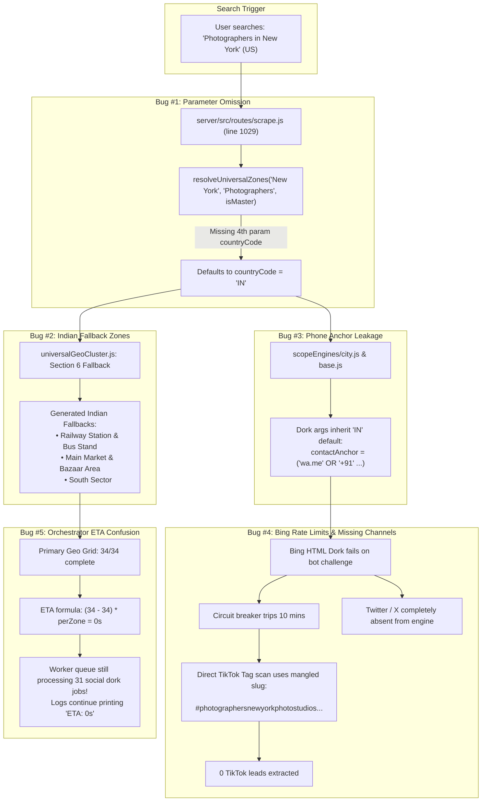

# Master Implementation Plan: Social Discovery, Country Zones & Lead Squeeze Fleet

> **Target Systems**: Universal Geo-Clustering, Quad-Channel Social Extraction (TikTok, X/Twitter, Instagram, Facebook), Multi-Engine Dorking, Orchestrator Progress Transparency, Client & Master UI Intel Surfacing, and High-Yield Lead Squeezing.  
> **Environment**: Windows 11, Node.js / Express backend, Vite / React client & master frontends. Offline-first, keyless architecture with 0 paid API keys.

---

## 1. Executive Summary & Plain-English Log Diagnosis

When you ran **"Photographers in New York"**, you noticed logs continuing long after the scrape appeared finished, with unexpected search queries like:
```text
[Social Discovery] Searching: "site:tiktok.com Photographers New York · Photo Studios & Digital Labs ("wa.me" OR "+91" OR "call" OR "contact" OR "whatsapp")" (US)
[Social Discovery] Bing challenge encountered; fast-forwarding to Direct Stealth Discovery...
[Social Discovery] No tiktok results found for "Photographers New York · Photo Studios & Digital Labs"
[Orchestrator] Progress: 34/34 zones complete. 31 pending, 4 running. ETA: 0s
[Social Discovery] Done: facebook inserted 0 leads for "Photographers New York South Sector".
```

### What Each Part of Your Log Means

| Log Line | What It Actually Means | Why It Happened (Root Cause) |
| :--- | :--- | :--- |
| `Progress: 34/34 zones complete. 31 pending, 4 running. ETA: 0s` | The 34 primary geographic map zones finished scanning, but **31 background auxiliary jobs** (Social dorking across Instagram, Facebook, TikTok, and website contact extractors) were still running in the background queue. | The orchestrator calculates ETA based *only* on geographic grid zones (`Math.max(0, totalZones - completedZones)`), which hit $34 - 34 = 0$ ($0\text{s}$), while the worker queue still held 31 pending social dork tasks. |
| `("wa.me" OR "+91" OR "call" OR "contact" OR "whatsapp") (US)` | A US search query erroneously injected the Indian country code (`+91`) and Indian WhatsApp dork anchor into a US TikTok search. | In `server/src/routes/scrape.js`, `resolveUniversalZones` was called without the 4th parameter (`countryCode`), defaulting to `'IN'`. When subvectors were resolved, they inherited the `'IN'` default before being dispatched to the social dorker. |
| `Photographers New York South Sector` | An Indian municipal zoning format (`South Sector`, `Railway Station & Bus Stand`, `Main Market & Bazaar Area`) was used for New York City! | In `server/src/services/sweepScopePolicy.js` and `universalGeoCluster.js`, when a city plan had fallback sectors generated, it used the Indian municipal fallback array instead of international metropolitan districts (Midtown, Downtown, Seaport, Arts District). |
| `Bing challenge encountered; fast-forwarding to Direct Stealth Discovery...` | Bing flagged the automated search query for TikTok and returned a bot challenge / CAPTCHA page. | High-frequency querying without rotating search fallbacks trips Bing's rate-limiter, activating an internal 5-to-10-minute circuit breaker. |
| `No tiktok results found for "Photographers New York · Photo Studios & Digital Labs"` | The stealth fallback failed to find any TikTok accounts. | The fallback attempted to open a TikTok hashtag using the entire unstripped subvector title `#photographersnewyorkphotostudiosdigitallabs`, which does not exist on TikTok. |

---

## 2. Deep Root Cause Analysis



---

## 3. Country-Specific Transit, Commercial & Geographic Architecture

To ensure 100% geographic authenticity, city sectors and transit hubs must strictly match the target country:

| Country Code | Core Commercial Sectors | Transit Hubs & Corridors | Industrial / Outskirts |
| :--- | :--- | :--- | :--- |
| **US** | Downtown & Commercial Core, Financial District, Midtown, Uptown | Metro / Central Rail Station, Seaport / Waterfront | Tech Corridor, Interstate Commercial Park |
| **GB (UK)** | High Street, City Centre, Market Square, Commercial Quarter | Central Railway Station, Underground / Interchange Hub | Trading Estate, Enterprise Park |
| **CA** | Downtown Core, Financial District, Old Town / Port Area | Central Station, Transitway Corridor | Industrial Business Park, Logistics Park |
| **AU** | CBD, Shopping Precinct, Waterfront Quarter | Central Railway Hub, Interchange Station | Business & Technology Park |
| **AE** | Downtown & Financial Centre, Business Bay, Marina / Waterfront | Metro Station Corridor, Highway Arterial (SZR) | Industrial Area & Freezone |
| **DE** | Stadtzentrum / Innenstadt, Altstadt | Hauptbahnhof (Central Station) Corridor | Gewerbegebiet & Industriegebiet |
| **FR** | Centre-Ville, Quartier d'Affaires | Gare Centrale & Pôle d'Échange | Zone Industrielle & Commerciale |
| **IN** | Central Commercial Hub, Main Market & Bazaar Area, Mandi | Railway Station & Bus Stand, Ring Road | Industrial Area & GIDC/MIDC Estate |

---

## 4. Quad-Channel Social Discovery Engine (TikTok, X, Instagram, Facebook)

- **Instagram**: Bio, followers, WhatsApp link, link-in-bio, phone with target country anchors.
- **Facebook**: Page URL, official phone, messenger link, physical address, reviews.
- **TikTok**: `@handle`, followers, likes, bio contact, link-in-bio (US/UK/CA/AU/AE/DE/FR; strictly bypassed in India).
- **X / Twitter**: `@handle`, bio description, follower count, verified badge, pinned link via OpenGraph parser.
- **Multi-Engine Failover**: Bing HTML $\rightarrow$ DuckDuckGo HTML fallback $\rightarrow$ Clean OpenGraph meta scraper.

---

## 5. Orchestrator Progress Reporting & Accurate ETA

- Separate progress tracking into Stage 1 (Geo Grid) and Stage 2 (Social & Contact Scouts).
- ETA formula accounts for pending auxiliary tasks when geo grid reaches 100%:
  $$\text{ETA} = \left\lceil \frac{N_{\text{aux\_pending}} + N_{\text{aux\_running}}}{\text{Concurrency}} \right\rceil \times T_{\text{aux}}$$
- No more confusing `Progress: 34/34 complete. 31 pending, ETA: 0s` loops.

---

## 6. Real-Time UI Surfacing in Client & Master Consoles

- **Leads Table View**: Live interactive badges for Instagram (`#E1306C`), Facebook (`#1877F2`), TikTok (`#00F2FE`), X (`#0f172a`), and WhatsApp (`#22c55e`).
- **CSV & VCF Export**: Added columns for Instagram, Facebook, TikTok, and X.
- **Vendor Drawer**: Follower count pills and verified profile links.

---

## 7. Generic Search vs Particular Search Differentiation

- **Generic Search**: Expands query across 8–16 subvectors and 24–48 localized commercial sectors for broad market coverage and maximum lead volume.
- **Particular / Specific Search**: Strict domain purity, zero subvector drift, aggressive negative keyword exclusion, and high-yield contact squeeze on exact matching businesses.

---

## 8. Verification & Test Plan

1. Verify `resolveUniversalZones('New York', ...)` produces 0 Indian terms.
2. Verify `resolveUniversalZones('Guntur', ...)` preserves 100% of Indian trade terms.
3. Test `getCountryContactAnchors` for US, GB, AU, AE, DE, FR, IN.
4. Verify client and master production builds with `npm run build`.
