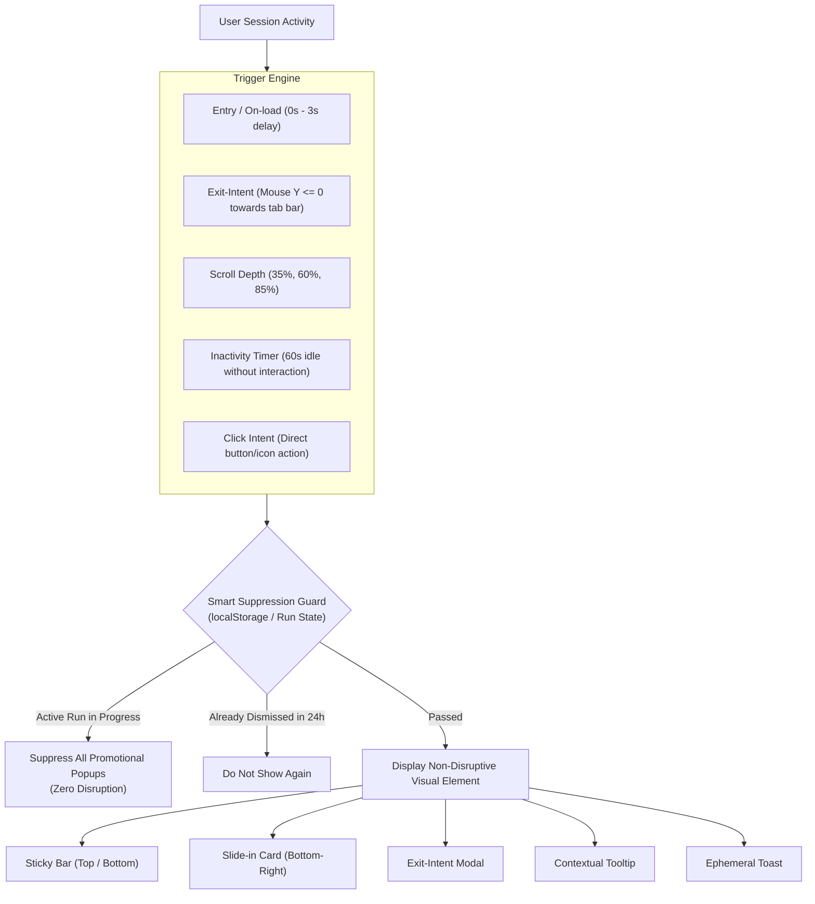
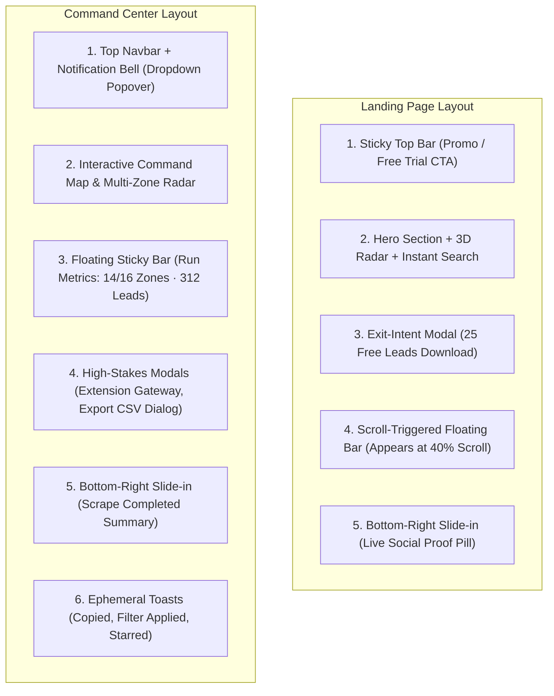

# Visual Formats, UI Elements & Behavioral Triggers Architecture Plan

## Executive Summary
This document establishes the UI component architecture, trigger choreography, and placement strategy for interactive visual formats across the **Client** and **Master** web applications. It details how to implement **Modals, Slide-ins, Sticky Bars, Welcome Mats, Popovers, and Toasts** paired with **Entry, Exit-Intent, Scroll, Inactivity, and Click triggers** to maximize user conversion and customer retention on the **Landing Page**, while preserving zero-distraction focus in the **Command Center**.

---

## 1. Visual Formats & UI Elements Breakdown

| Visual Format | UI Description | Screen Footprint | Blocking? | Primary Purpose | Master vs. Client Usage |
| :--- | :--- | :--- | :--- | :--- | :--- |
| **Modal / Lightbox** | Centered elevated dialog with blurred backdrop (`backdrop-blur-md bg-black/60`). | 400px–680px centered box | **Yes** (Blocks background interaction) | High-stakes decisions: Auth, Export Config, Extension Pairing, Destructive Actions. | **Client**: Auth, Extension Gateway, CSV Export.<br>**Master**: Cluster Abort, Vault Purge, Engine Debug. |
| **Slide-in (Drawer/Card)** | Card smoothly entering from bottom-right or side (e.g. `transform: translateX(0)`). | 320px–420px docked to edge | **No** (User can keep interacting with page) | Secondary notifications, social proof, completed mission summary, feedback. | **Client**: "Mission Complete: 184 Leads Found", Social Proof.<br>**Master**: Engine Failover alert, Quota Warning. |
| **Floating / Sticky Bar** | Ultra-thin persistent ribbon anchored to screen top or bottom (`fixed top-0` / `bottom-0`). | Full width $\times$ 44px–52px | **No** (Minimal vertical footprint) | Value proposition announcement, global search status, countdown timer, RAM health. | **Client Landing**: Free trial CTA / discount.<br>**Command Center**: Global Run Progress Strip. |
| **Fullscreen Takeover / Welcome Mat** | 100vw $\times$ 100vh full-page view overlaying viewport. | 100% viewport | **Yes** | Guided interactive product demo, first-time user tour, system onboarding. | **Client Landing**: Interactive live radar simulation.<br>**Master**: First-run system check. |
| **Pop-under / Background Tab** | External window or out-of-focus background worker tab. | Background window/tab | **No** | Scraping worker execution, Extension off-screen document. | *Never use for spam.* Used strictly for Extension RAM background worker tab. |
| **Tooltip / Popover** | Micro-card tethered to an anchor element with arrow pointer. | 180px–340px floating card | **No** (Transient hover/click) | Contextual guidance: zone radar explanation, stealth score, phone verification badge. | **Both**: Explaining metrics, engine latency, filters, keyboard shortcuts. |
| **Toast / Notification Banner** | Transient badge appearing at top-right or bottom-center (fades after 3–4s). | 280px–360px floating pill | **No** (Auto-dismissing) | Action confirmations: "Copied to clipboard", "Starred lead", "Engine resumed". | **Both**: System feedback via `react-hot-toast`. |

---

## 2. Behavioral Triggers & Mechanics



### Trigger Breakdown:
1. **Entry / On-load**:
   * *Landing Page*: Sticky top banner appears after a 1.5s smooth drop-in.
   * *Guard*: Never show aggressive modals on instant load; it causes high bounce rates.
2. **Exit-Intent**:
   * *Mechanism*: Listen to `mouseleave` on `document.documentElement` when `e.clientY <= 0` and `e.relatedTarget === null`.
   * *Landing Page*: Triggers "Wait! Take 25 Free Leads in Your City" sample modal.
   * *Command Center*: Triggers "Unsaved Search: Export your 184 leads before closing" if leads exist in the current session.
3. **Scroll-Triggered**:
   * *Landing Page*: When user scrolls past 40% (after Hero, entering Solutions/Architecture), the Floating Sticky CTA bar slides into view.
4. **Time / Inactivity-Triggered**:
   * *Command Center*: If the user has been idle for 90 seconds while a scraping session has completed, show a gentle bottom-right slide-in: *"Your 240 leads are ready in Session Vault. Click here to export to Excel."*
5. **Click-Triggered**:
   * Direct user intent: clicking "Export", "Select Country", "Extension Help", or hovering over an Engine Status icon.

---

## 3. Master vs. Client Application Strategy

### Client Application (Customer Retention & Lead Acquisition)
* **Goal**: Convert visitors into active users, maintain excitement during scraping, and guide them to export verified leads.
* **Key Visual Elements**:
  1. *Landing Page Hero*: Sticky Top Value Bar + Exit-intent lead sample modal.
  2. *Live Social Proof Slide-in*: Periodic bottom-right pill showing anonymized recent search metrics (*"A user in Pune just harvested 142 B2B Leads"*).
  3. *Command Center Search Console*: Clean, fresh auto-suggestions without intrusive folders or stale history chips.
  4. *Active Run Floating Ticker*: Sticky bottom bar showing live speed (Leads/sec, Mobiles verified) while user explores the map.

### Master Application (Admin & Operator Command)
* **Goal**: Real-time observability, engine health, zero latency, maximum operational control.
* **Strict Anti-Disruption Policy**:
  * **Zero promotional popups, zero marketing banners.**
  * Only operational modals (destructive confirmations, cluster configurations).
  * System health toasts and live status tooltips on engine latency and proxy pools.

---

## 4. Placement Blueprint: Landing Page vs. Command Center



### Exact Component Placement Details:

#### A. Landing Page (`client/src/v2/landing/`)
1. **Floating / Sticky Bar (Top Bar)**:
   * *Location*: Above `LandingNavbar.jsx`, `fixed top-0 z-40`.
   * *Trigger*: On-load after 1.5s delay.
   * *Content*: *"🔥 New: Direct WhatsApp & Mobile Extraction active across 11 countries · [Try Instant Demo →]"*
   * *Behavior*: Dismissible with $\times$; persists dismissal in `localStorage.getItem('promo_bar_dismissed')` for 7 days.
2. **Exit-Intent Modal**:
   * *Location*: Centered overlay `z-50`.
   * *Trigger*: User cursor exits viewport top (`e.clientY <= 0`) on desktop.
   * *Content*: High-value lead magnet: *"Before you go, preview 25 Verified Local Leads in [Detected City] — Free instant CSV."*
   * *Guard*: Only fires once per session (`sessionStorage.getItem('exit_modal_shown')`).
3. **Scroll-Triggered Sticky CTA (Bottom Bar)**:
   * *Location*: `fixed bottom-4 left-1/2 -translate-x-1/2 z-40`.
   * *Trigger*: Appears only when `window.scrollY > 600px` (when Hero is scrolled past).
   * *Content*: Compact glassmorphic pill with search input shortcut or "Start Free Search" button.
4. **Slide-in Notification (Bottom-Right)**:
   * *Location*: `fixed bottom-6 right-6 z-30`.
   * *Trigger*: Time-delayed (every 45s, displays for 6s, cycles 3 messages).
   * *Content*: Glassmorphism card: *"⚡ Verified 384 Turmeric Wholesalers in Tenali Mandals (AP) — 98% Mobiles."*

#### B. Command Center (`client/src/v2/CommandCenter.jsx`)
1. **Non-Disruptive Operational Modals**:
   * *Extension Gateway Modal*: Click-triggered or auto-prompted *only* when RAM Mode is clicked without extension detected.
   * *Export Modal*: Click-triggered when clicking "Export Leads". Lets user customize columns (Name, Mobile, WhatsApp, Rating, Address).
   * *Merge/Rename Modals*: In folder view for lead organization.
2. **Bottom-Right Slide-In ("Mission Completed" Drawer)**:
   * *Location*: `fixed bottom-6 right-6 z-40`.
   * *Trigger*: Automatically appears 1.5s after all zones reach 100% completion.
   * *Content*:
     * *"🎉 Search Complete: 312 leads harvested (214 mobile numbers, 182 WhatsApp ready)."*
     * Action Buttons: `[Download CSV]` `[Inspect Folder]`.
     * Does **not** block map panning, zooming, or lead selection.
3. **Floating Progress Bar (Active Run Ticker)**:
   * *Location*: Docked below the top navbar or above the footer controls.
   * *Trigger*: Active while `running === true`.
   * *Content*: Shows real-time zone progress, active parallel engines, and mobile counter.
4. **Tooltips & Popovers**:
   * Hovering over Engine icons (Google Places, JustDial, Instagram Dork) displays live latency, stealth score, and leads yielded.
   * Hovering over radar zone slices displays zone name, boundary radius, and lead yield.

---

## 5. Non-Disruptive UX Rules & Technical Guards

To guarantee that popups **never** ruin user retention or disrupt active lead generation:

1. **Active Run Lockout**:
   * If `running === true`, **all marketing popups, feedback slide-ins, and survey banners are strictly suppressed**. Operators must have 100% uninterrupted view of the map and data table.
2. **Z-Index Layering Hierarchy**:
   * `z-10`: Base interactive map, canvas, table.
   * `z-20`: Floating sticky bars (Top/Bottom ribbons).
   * `z-30`: Tooltips, popovers, dropdowns.
   * `z-40`: Non-blocking slide-in cards (bottom-right notifications).
   * `z-50`: High-priority blocking Modals (Extension, Export, Auth).
   * `z-60`: System Toasts (`react-hot-toast`).
3. **Storage-Backed Frequency Capping**:
   * Exit-intent modal: Max **1 time per 72 hours** (`localStorage`).
   * Promo sticky bar: Max **1 dismissal per 7 days**.
   * Social proof slide-in: Suppressed automatically once user initiates a search.
4. **Mobile Responsiveness**:
   * Exit-intent does not exist on mobile touchscreens (no mouse exit); fallback to a subtle bottom slide-in when user reaches 80% scroll depth.
   * Modals on mobile must adapt to bottom-sheet drawers (`sheet-bottom`) for native thumb reachability.

---

## 6. Implementation Architecture

### Reusable UI Elements Directory Structure
```text
client/src/v2/components/
├── banners/
│   ├── StickyPromoBar.jsx         <-- Top/Bottom dismissible announcement bar
│   └── ActiveRunStickyTicker.jsx  <-- Live scraping progress ribbon
├── popups/
│   ├── ExitIntentModal.jsx        <-- Cursor departure lead-magnet dialog
│   ├── SocialProofSlideIn.jsx     <-- Bottom-right live activity notification
│   └── MissionCompleteDrawer.jsx  <-- Post-run completion action drawer
├── tooltips/
│   ├── ModernTooltip.jsx          <-- Reusable hover tooltip with micro-arrow
│   └── EngineStatusPopover.jsx    <-- Interactive engine health popover
└── hooks/
    ├── useExitIntent.js           <-- Clean mouseout listener with storage guard
    ├── useScrollTrigger.js        <-- Viewport scroll depth observer
    └── useInactivityTrigger.js    <-- User idle detection hook
```

---

## 7. Phased Implementation Roadmap

- [ ] **Phase 1: Hooks & Utility Infrastructure**
  - Implement `useExitIntent.js` (detects cursor exit towards tab bar with suppression guard).
  - Implement `useScrollTrigger.js` (fires callbacks at 30%/60%/90% scroll depth).
  - Implement `useInactivityTrigger.js` (tracks mouse/keyboard idle state).
- [ ] **Phase 2: Landing Page Conversion Elements**
  - Build `StickyPromoBar.jsx` for the top of `LandingLayout.jsx`.
  - Build `ExitIntentModal.jsx` offering free sample lead preview.
  - Build `SocialProofSlideIn.jsx` showing real-time anonymized lead activity.
- [ ] **Phase 3: Command Center Non-Disruptive Elements**
  - Build `MissionCompleteDrawer.jsx` (smooth bottom-right slide-in when `running` transitions to `false` with leads).
  - Build `EngineStatusPopover.jsx` for the status board.
  - Ensure all promotional formats are silenced during active scraping.
- [ ] **Phase 4: Multi-Browser & Responsive Validation**
  - Test desktop Chrome, Edge, Firefox, and mobile touch viewports.
  - Verify zero console errors and clean build in both `client` and `master`.
