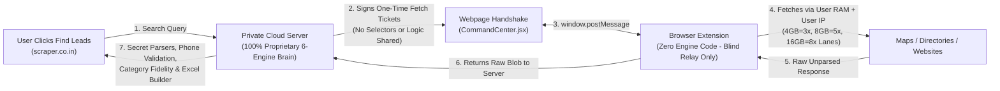

# Zero-Knowledge Extension-Only Deployment Plan (`Scraper.co.in`)

> **Core Promise:** All **6 months of your proprietary scraping engines, AI intelligence, geo-hierarchy (619k+ villages), parsing rules, and deduplication logic stay 100% locked on your private server**. Nobody can inspect or reverse-engineer your engines because the Chrome/Edge Browser Extension contains **zero engine logic**—it acts purely as a **Blind Memory & Network Relay** running inside the user's browser RAM.

---

## 1. The Big Idea in Simple Language

Think of your architecture like a **Secure Cloud Brain + User Muscle (Browser Extension)**:

1. **Your Server = The Secret Brain (100% Private, Impossible to Reverse-Engineer):**
   - Your existing proprietary engine codebase stays **exclusively inside your private `server/` backend**:
     - `server/src/services/omniSearchOrchestrator.js` (zone swarm orchestration & multi-engine sequencing)
     - `server/src/utils/universalGeoCluster.js` (619,287 Indian villages, mandals, districts & international sector vectors)
     - `server/src/utils/tradeIntelligence.js`, `categoryRouter.js`, `categoryFidelity.js` (Store vs. Product vs. Service vs. Vendor intent routing & off-topic filtering)
     - `server/src/scrapers/engine-google-places.js`, `engine-google-serp-local.js`, `engine-justdial.js`, `engine-web-contact.js`, `engine-puppeteer-indiamart.js`, `engine-openstreetmap.js` (DOM/HTML/JSON parsers, regex patterns, contact validation, phone normalization, and deduplication)
   - **Nothing inside `server/` is ever shipped to the browser or extension.**

2. **The Browser Extension = Blind User-RAM & User-IP Relay (~90 Lines of Generic Transport Code):**
   - Even if a competitor unzips the extension (`extension/`), all they will ever see is a generic listener that:
     1. Receives a short-lived HMAC-signed **one-time fetch ticket** from your server (`{ ticketId, taskType, encryptedPayload, expiresAt }`).
     2. Uses the **user's own browser RAM, CPU threads, and home/office internet IP** to fetch or render the target page inside a temporary isolated tab/worker in their browser memory.
     3. Immediately posts the **raw unparsed HTML/JSON payload** back to your server (`POST /api/scrape/relay-result`) and wipes it from local browser memory.
   - Because the extension has **zero CSS selectors, zero category keywords, zero geo-databases, and zero parsing code**, your 6 months of engineering intellectual property **cannot be copied or reverse-engineered**.

3. **Extension-Only Cloud Deployment (`SCRAPER_EXTENSION_ONLY=true`):**
   - When deployed in production (Docker / Kubernetes), your cloud server does **not** launch heavyweight Playwright Chromium browsers (`SCRAPER_BROWSER_SLOTS=0`).
   - Instead, users install the **`Scraper.co.in RAM Turbo`** Chrome/Edge extension once (30 seconds).
   - Every search runs using **their RAM + their residential IP** for fetching while **your server's 6 engines** process, clean, deduplicate, and stream the final leads live to their screen and Excel sheet.
   - **Result for you:** 95% lower cloud server bill (a tiny 1–2 GB RAM cloud node can serve 500+ concurrent users), zero datacenter IP bans, and 100% IP protection for your code.

---

## 2. How It Works Step by Step (Zero-Knowledge Flow)

| Step | Where It Runs | What Happens | What Anyone Inspecting Client/Extension Can See |
| :--- | :--- | :--- | :--- |
| **1. Geo & Category Planning** | **Server Only** | Splits city/mandal/district into neighborhood pockets & category vectors (`universalGeoCluster.js`, `categoryRouter.js`) | Only generic opaque ticket IDs |
| **2. Page / Network Fetching** | **User's Extension (User RAM & IP)** | Executes signed fetch/tab request in user's browser RAM (`3x`, `5x`, or `8x` parallel lanes) | Generic HTTP/DOM fetch wrapper (~90 lines), **zero secrets** |
| **3. Data Extraction & Cleaning** | **Server Only** | Runs all 6 proprietary parsers, phone libphonenumber checks, category fidelity filter, and deduplication | Completely hidden on server (`engine-*.js` never leaves server) |
| **4. Live UI & Excel Export** | **Command Center** | Streams verified leads over SSE (`/api/logs/stream`) to Satellite Map & Excel/CSV exporter | Final clean business leads for their paid search only |

---

## 3. Security & Anti-Reverse-Engineering Safeguards

1. **Zero Selectors in Client / Extension:**
   - The extension never knows how Google Maps cards, JustDial mobile API payloads, B2B profiles, or business websites are parsed. If target sites change their HTML tomorrow, you update your **server** once—every user gets the fix instantly without updating the extension.
2. **Short-Lived HMAC-Signed One-Time Tickets:**
   - Every relay ticket expires in **30 seconds**, is bound to the user's authenticated session ID, and can only be redeemed **once** (`POST /api/scrape/relay-result`).
3. **Extension Heartbeat Required in Extension-Only Production Mode:**
   - When `SCRAPER_EXTENSION_ONLY=true` is active in Docker/Kubernetes, `/api/scrape/auto` and `/api/scrape/omni` verify `req.headers['x-extension-ready']` / active relay heartbeat before starting a sweep. If not installed yet, the UI shows the 1-click **`Install Extension (30s Setup)`** card instead of burning your server CPU.
4. **No Local Storage of Raw Leads in Extension:**
   - The extension forwards each zone response to your server and immediately releases the buffer from RAM.

---

## 4. Phase-by-Phase Implementation Plan

### Phase 1: Create the Zero-Knowledge Browser Extension (`extension/`)
Create a minimal, clean Manifest V3 Chrome / Edge / Brave extension containing **zero proprietary scraping logic**:
- **New files to create:**
  - `extension/manifest.json` — Manifest V3 metadata, permissions (`storage`, `scripting`, `tabs` or `offscreen`), `host_permissions` (`<all_urls>`), matches `https://scraper.co.in/*` and `http://localhost:*/*`.
  - `extension/contentBridge.js` — Lightweight page bridge injected onto `scraper.co.in` and `localhost` that responds to `SCRAPER_EXT_PING` with `{ status: 'READY', extensionVersion }` and forwards relay tickets between the server/page and background worker.
  - `extension/background.js` — Blind Ticket Worker: maintains `concurrency = 3 | 5 | 8` based on the user's detected RAM tier, opens/fetches ticket targets in user RAM, extracts raw HTML/text or JSON, returns `{ ticketId, status, body }` to `POST /api/scrape/relay-result`, and cleans up memory immediately.
  - `extension/popup.html` & `extension/popup.js` — 3D Game Boy Color mini extension popup showing connection status (`🟢 CONNECTED TO SCRAPER.CO.IN`), detected RAM/CPU speed tier, and a 1-click button to open the Command Center.

### Phase 2: Server-Side Blind Ticket Hub & Extension-Only Mode (`server/`)
- **New / updated files:**
  - `server/src/services/extensionRelayHub.js` *(new)* — Manages active user relay SSE connections (`GET /api/scrape/relay-stream`), creates signed 30-second fetch tickets (`requestExtensionFetch({ sessionId, userId, url, mode, headers })`), resolves promises when `POST /api/scrape/relay-result` arrives, and enforces per-session rate/size bounds.
  - `server/src/routes/scrape.js` *(update)* —
    - Add `GET /api/scrape/relay-stream`, `POST /api/scrape/relay-result`, and `GET /api/extension/download` (packages `extension/` as a clean downloadable `.zip` directly from the server so users can load it right away or via Chrome Web Store).
    - Add `SCRAPER_EXTENSION_ONLY=true` guard so in cloud deployment no server-side Chromium is spawned (`0 MB` browser RAM on server), routing raw fetches through `extensionRelayHub` while keeping 100% of parsing inside your server engines.
  - `server/src/scrapers/` wrappers *(minimal hook in shared HTTP/browser helpers)* — When `SCRAPER_EXTENSION_ONLY=true` (and for users with the extension active), fetch calls delegate the network/render step to `extensionRelayHub` and pass the returned raw payload straight into your existing server-side engine parsers unchanged.

### Phase 3: Clear, Simple-Language Explanation on the Landing Page
Update `client/src/v2/LandingV2.jsx` and `master/src/v2/LandingV2.jsx` (and CSS if needed) with a dedicated section written in simple, non-technical language for customers:
- **Section Headline:** *"Powered by Our 6 Cloud Engines + Your Browser Extension"*
- **3 Clear Visual Cards:**
  1. **6 Months of Proprietary Engine Intelligence (Runs on Our Server):** Explains simply that our smart search brain, 619k+ Indian village database, store/product/service AI, and Excel cleaners run securely in our cloud—always up to date, zero configuration.
  2. **Turbocharged by Your Device RAM (Runs via Our Safe Extension):** Shows the exact RAM tiers (`4GB RAM → 3 Parallel Zones`, `8GB RAM → 5 Parallel Zones`, `16GB+ RAM → 8 Parallel Zones`) in plain English—why installing our tiny extension gives them instant speeds with zero cloud waiting queues.
  3. **Quick 30-Second Install + Free Trial Guarantee:** Simple 3-step visual walkthrough (`1. Add Extension → 2. Type "Shops in City" → 3. Download Clean Excel`) with clear reassurance that the extension **only runs when you press Search** on `scraper.co.in` and never reads personal tabs or passwords.

### Phase 4: Command Center Extension-Only Gate & 1-Click Setup Modal
Update `client/src/v2/CommandCenter.jsx` and `client/src/v2/utils/deviceRamEngine.js` (and `master/` equivalents):
- Detect whether the **`Scraper.co.in RAM Turbo`** extension is installed and connected (`window.postMessage` handshake).
- In the **3D Game Boy Color Hardware Popup Modal**:
  - When Extension is connected: shows **`🟢 RAM EXTENSION ACTIVE (v1.0) · 6 SERVER ENGINES + YOUR <X>GB RAM READY`**.
  - When Extension is missing (especially in `extension_only` deployment): shows a friendly **`[A] INSTALL SCRAPER RAM EXTENSION (30 SECONDS)`** button with direct `.zip` / Web Store link and automatic auto-detect once installed (no page refresh needed).

### Phase 5: Extension-Only Docker & Kubernetes Production Config
Update deployment manifests so cloud production enforces Extension-Only mode by default:
- `docker-compose.prod.yaml` & `Dockerfile.server` — Set `SCRAPER_EXTENSION_ONLY=true`, `SCRAPER_BROWSER_SLOTS=0`, keeping server container memory tiny and fast.
- `k8s/configmap.yaml` & `k8s/server-deployment.yaml` — Set `SCRAPER_EXTENSION_ONLY: "true"` and `SCRAPER_BROWSER_SLOTS: "0"` so each lightweight pod handles hundreds of users cleanly.

---

## 5. How We Will Verify Everything After Your Approval

1. **Reverse-Engineering Audit:** Inspect every file inside `extension/` and confirm **0%** of your server engine code, CSS selectors, geo JSON/CSV indexes, or trade intelligence maps exist in the extension or frontend bundle.
2. **End-to-End Relay Test:** Load the unpacked extension in Chrome, trigger a live search (`Camera Shops in Vijayawada`), confirm fetch tickets flow over `/api/scrape/relay-stream` → Extension (User RAM) → `/api/scrape/relay-result` → Server 6-Engine Parsers → Command Center Satellite Map & Excel Export, while server-side Chromium remains idle (`0` server browsers launched in `SCRAPER_EXTENSION_ONLY=true` mode).
3. **Production Build & Landing Check:** Run `npm run build` for `client` and `master`, test `/api/extension/download` (`200 application/zip`), and verify the Landing Page explanation renders cleanly across desktop and mobile widths.

---

> **Ready for your review.** Reply **`Approve`** (or click **Proceed** on the plan artifact) whenever you want me to implement Phases 1–5!
