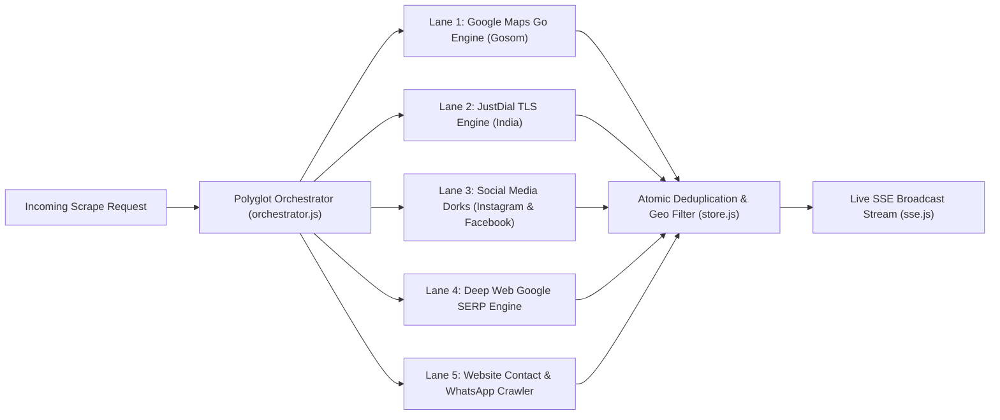

# Parallel Polyglot Scraping Governance & Multi-Lane Architecture

## 1. Zero-Chromium Directive

- **Never launch full Chromium, Playwright, Puppeteer, or Selenium browser instances.**
- Traditional browser automation consumes 300MB–2GB+ RAM per instance, crashes low-tier VPS environments, and reliably triggers Cloudflare and Google anti-bot challenges.
- Our platform uses the **Zero-Chromium Polyglot Fleet**: native compiled binaries, Rust/C TLS impersonators, and pure HTTP stream processors running concurrently.

---

## 2. The 5 Parallel Scraping Lanes

When a scrape sweep is triggered, the **Polyglot Orchestrator (`server/src/orchestrator.js`)** fans out across up to 5 concurrent lanes based on target geography and intent:

### Lane 1: Google Maps Go Engine (`gosom`)
- **Technology**: Native compiled Go binary (`server/bin/google_maps_scraper.exe`).
- **Role**: Spatial grid sweeps across target city mandals/zones without browser rendering.
- **Execution**: Direct HTTP/2 requests with geographic bounding boxes and localized query subvectors.
- **Data Yield**: Business name, street address, coordinates, Google star rating, review count, landlines, and listed mobiles.

### Lane 2: JustDial TLS Impersonation Engine (`scrapeJustdialTls`)
- **Technology**: Python sidecar on port `5003` powered by `curl_cffi` (C) and `primp` (Rust).
- **Role**: High-intent Indian directory extraction (`country === 'IN'`).
- **Mechanism**: Impersonates real Chrome/Safari TLS JA3 fingerprints over HTTP/2, effortlessly bypassing Cloudflare protection without CAPTCHAs.
- **Data Yield**: Instant proprietor 10-digit mobile numbers (`/^[6-9]\d{9}$/`), locality landmarks, and verified trade categories.

### Lane 3: Social Media Dork & Bio Phone Hunter (`scrapeSocialDorks`)
- **Technology**: Pure Node.js zero-browser search dorking.
- **Role**: Uncovers social media business accounts on **Instagram** and **Facebook**.
- **Mechanism**: Evaluates targeted query dorks (e.g. `site:instagram.com "bakeries" "Guntur"`). Parses profile bios and meta descriptions for personal mobile numbers and WhatsApp links.
- **Data Yield**: Instagram profile URLs, Facebook pages, direct founder mobile numbers.

### Lane 4: Deep Web Google SERP Engine (`scrapeDeepWebSerp`)
- **Technology**: Pure HTTP paginated search engine crawler.
- **Role**: Crawls indexed organic search result pages (`Gooooooogle` pagination).
- **Mechanism**: Discovers official company homepages, local directory anchors, and indexed phone numbers across web search results without running a browser.
- **Data Yield**: Official company website URLs, domain emails, and snippet contact information.

### Lane 5: In-Flight Website Contact & WhatsApp Crawler (`extractDeepBusinessContacts`)
- **Technology**: Pure Node.js async HTTP parser with Python TLS fallback.
- **Role**: Non-blocking deep inspection of company websites discovered in Lanes 1–4.
- **Mechanism**: Performs rapid 3-second fetches of `/`, `/contact`, and `/about`. Scrapes `<a href="tel:...">`, `<a href="https://wa.me/...">`, and regex for owner mobile numbers and business emails.

---

## 3. Strict System RAM Guardrail (< 150 MB Total)

- The entire running system (Node backend + Python TLS sidecar + Go binary) must remain **strictly under 150 MB RAM at all times**.
- Real-time verified telemetry:
  - Backend Engine + Python Sidecar idle: **~75 MB RAM**
  - Active 4-lane parallel sweep (100+ leads): **~88 MB RAM**
- No in-memory buffering of raw HTML strings. Stream each record immediately via Server-Sent Events (`sse.broadcastVendor`) and persist to disk journal (`vendors_journal.jsonl`).

---

## 4. Geographic Purity & Anti-Pollution Governance

- **Zero-Pollution Rule**: A search for Guntur must yield 100% Guntur businesses (0 Mumbai, 0 Delhi, 0 Mangalagiri).
- Bounding Box Verification: Every incoming lead from any lane must pass `isWithinCityBounds(lead, city)` before reaching the store or the frontend stream.
- Out-of-bounds leads are silently dropped before they can pollute user exports or CRM catalogs.
